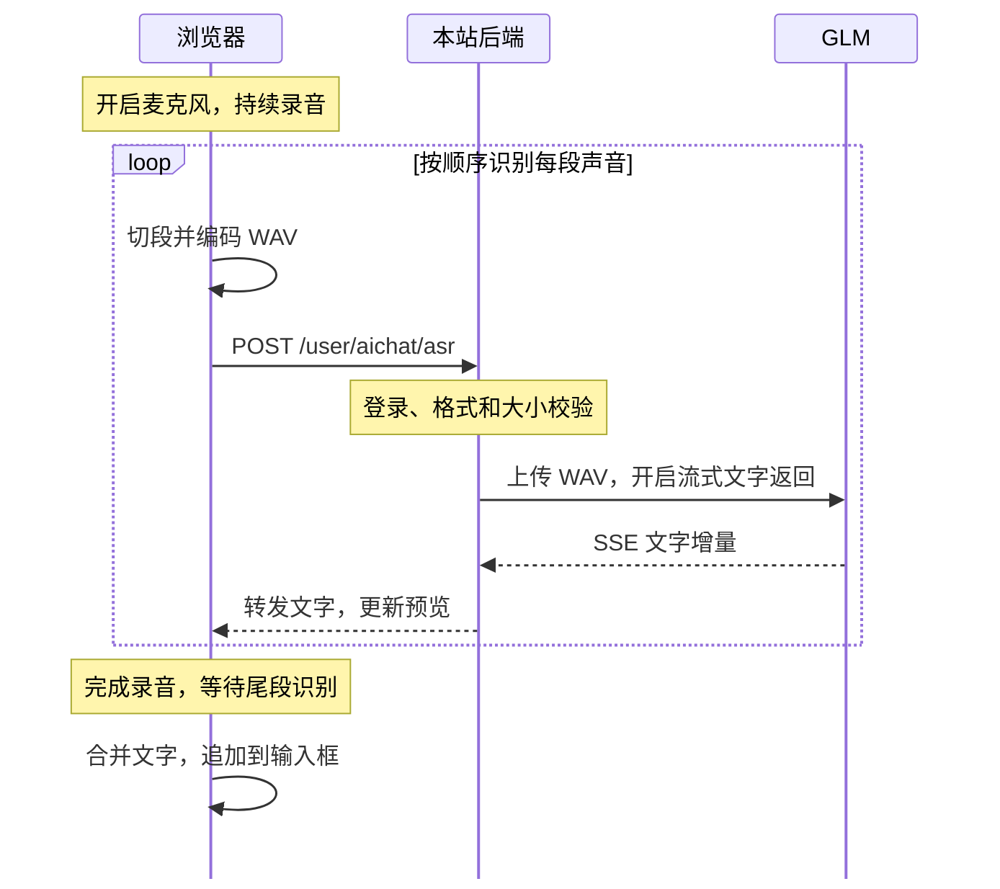
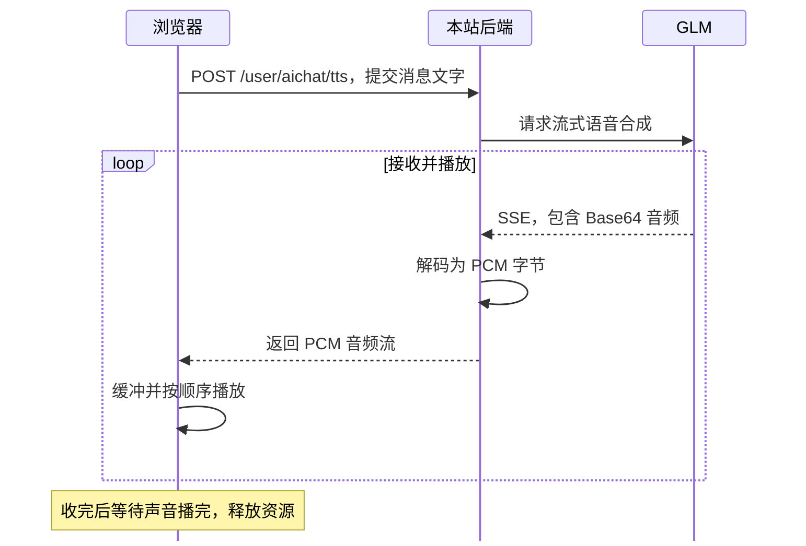

# 语音输入与朗读：ASR、TTS

AI 聊天中的语音功能分为两种：

| 功能 | 简单理解 | 页面上的操作 |
| --- | --- | --- |
| ASR，语音识别 | 把声音变成文字 | 点击麦克风说话，完成后把文字填入输入框 |
| TTS，语音合成 | 把文字变成声音 | 点击消息的朗读按钮，播放这条消息 |

两者都由 **浏览器 → 本站后端 → GLM 服务** 调用，密钥只保留在后端。语音输入不会自动发送聊天消息，朗读也不会重新生成 AI 回答。

## 1. ASR：说话怎样变成输入文字

### 录音和识别流程

1. **开始录音**：用户点击麦克风并授权，浏览器通过 AudioWorklet（音频处理线程）持续采集声音。
2. **切成音频段**：遇到停顿或达到时长上限，把已采集的一段声音编码为 WAV 文件。
3. **发送识别**：前端将 WAV 上传后端，后端检查格式和大小，再调用 GLM 的语音识别接口。
4. **显示预览**：GLM 通过 SSE 返回文字，后端立即转发，前端逐段更新录音面板。
5. **完成回填**：用户点击“完成”，或录音达到30秒上限，浏览器停止录音，等待剩余音频段识别完，再把合并文字追加到输入框。

识别过程中麦克风仍可采集下一段声音；识别请求按录制顺序逐个处理，避免文字顺序错乱。



### 什么时机会切段

| 情况 | 处理方式 |
| --- | --- |
| 当前段至少2秒，且连续静音至少0.5秒 | 按停顿切段 |
| 连续讲话，当前段达到8秒 | 切段，避免一直等待 |
| 点击“完成”或达到总计30秒 | 停止录音，提交剩余音频 |
| 整段没有检测到有效声音 | 不上传该段 |

例如，说话3秒后停顿，第一段会进入识别；此时可以继续讲话，面板陆续显示前一段文字。所以“边说边显示”仍有**采集一段 → 上传 → 识别**的等待，并非每个麦克风采样都实时传给 GLM。

停顿由音量判断，当前阈值为 RMS 大于 `0.003` 时视为有声音。它是简单的音量检测，背景噪声或声音过小会影响切段。各音频段独立识别，不会把上一段文字作为下一段的识别提示。

### 浏览器上传什么格式

浏览器实际采样率可能是48kHz等其他值，上传前会统一转换为：

| 项目 | ASR 上传格式 |
| --- | --- |
| 文件 | 标准44字节头的 WAV |
| 内容 | PCM，未压缩的声音采样 |
| 采样率 | 16kHz，即每秒16000个采样点 |
| 声道 | 单声道 |
| 位深 | 16位，小端字节序 |
| 时长 | 每次录音最多30秒；不足0.3秒提示重录 |

后端会检查 WAV 文件头和实际数据长度，不是只看 `.wav` 后缀。当前入口不接受 MP3、立体声或任意其他 WAV 格式。

### 完成、取消和重试

- **完成**：停止麦克风，提交尾段，等全部识别结束；文字追加到已有输入后，用户可以编辑再发送。
- **取消或切换会话**：停止录音、取消请求并清空预览，迟到的旧结果不会填入新会话。
- **识别失败**：保留本次已经录到的完整音频；点击“重试识别”会整体重新识别，成功后只回填一次，不把失败前的部分文字再追加一遍。
- **重新录音**：丢弃旧录音，开始新的录制。

录音只保存在本次页面内存中，ASR 不把它上传 OSS，也不保存到 MySQL。刷新后不能恢复这份录音。语音输入未完成时页面限制发送；AI 正在生成回答时不能开始新的录音。

## 2. TTS：消息怎样变成声音

### 从点击朗读到播放

1. **提交文字**：点击朗读，前端把该消息的 `content` 发给后端。
2. **请求合成**：后端将文字和音色交给 GLM，要求流式生成 PCM 音频。
3. **转换返回格式**：GLM 返回 SSE，其中用 Base64 字符串装载音频；后端解析事件并解码，取出真正的 PCM 音频字节。
4. **边收边播**：后端把 PCM 字节流返回前端，前端短暂缓冲后，通过 AudioContext（浏览器音频播放接口）按顺序播放。
5. **播放结束**：网络数据接收完后，等待已经排队的声音播完，再释放播放资源。



**前端 TTS 接收的是音频字节，不是 SSE 文字事件，也不是一个 MP3 下载地址。** Base64 只是上游用文本承载音频的方式，后端解码后才交给浏览器。

### 前端为什么能播放 PCM

PCM 可以理解为一串描述声音波形的数字，本身没有 WAV、MP3 那样的文件头。前端按约定格式读取这些数字：**24kHz、单声道、16位有符号小端 PCM**。

当前播放器先积累约0.3秒音频，再把16位整数转换为 AudioContext 使用的浮点采样，依次安排播放；最后不足缓冲长度的尾部也会提交播放。每次网络收到的字节数不一定刚好对应完整采样，因此前端会保留剩余字节，等下一批一起处理。

这里 ASR 的16kHz与 TTS 的24kHz用途不同：前者是录音上传格式，后者是播放器约定的合成音频格式。

### 停止和重新朗读

| 操作 | 当前行为 |
| --- | --- |
| 再次点击正在播放的同一条消息 | 停止请求和播放 |
| 同一条消息仍在加载时再次点击 | 不重复发起请求 |
| 点击另一条消息朗读 | 先停止原播放，再为新消息请求合成 |
| 页面组件卸载 | 取消请求并关闭音频播放资源 |
| 播完后再次点击 | 重新请求语音合成 |

TTS 音频在本次请求和播放内存中流转，不保存到 OSS、MySQL 或 Redis，也没有音频缓存或断点回放任务。

## 3. 两个接口分别返回什么

以下接口都需要登录，前端通过 Cookie 携带登录凭据。

| 项目 | ASR 语音输入 | TTS 朗读 |
| --- | --- | --- |
| 本站接口 | `POST /user/aichat/asr` | `POST /user/aichat/tts` |
| 请求格式 | FormData，`file` 为 WAV 文件 | JSON，`content` 为文字，`voice` 为可选音色 |
| 后端调用 GLM | `/audio/transcriptions` | `/audio/speech` |
| GLM 返回给后端 | SSE，内容是识别文字 | SSE，内容包含 Base64 PCM |
| 后端返回给浏览器 | `text/event-stream`，转发识别事件 | `audio/pcm`，解码后的音频字节流 |
| 前端处理 | 解析文字事件，更新预览 | 读取音频字节，调度播放 |

TTS 请求示例：

```json
{
  "content": "你好，有什么可以帮你？"
}
```

当前页面只发送 `content`，音色使用后端配置；调用接口时也可传 `voice` 覆盖本次音色。

ASR 每个音频段对应一次上传请求，并在同一次响应中接收识别文字。TTS 一次朗读对应一次请求。**两者都不使用 AI 回答的 `stream_id`、Redis Stream 或回放订阅接口**；取消请求会中止对应上游调用。

ASR 的 SSE 以供应商结束标记（例如 `data: [DONE]`）结束，前端确认后合并结果。TTS 后端将上游结束标记转换为音频流结束，前端读完后等待声音播完；不会收到聊天回答的 `done` 事件。

## 4. 模型和音色配置

两种功能都使用 `[aiModelConfig]` 中的 `glmApiKey`、`glmBaseUrl`。下面是模型与音色的配置示例：

```toml
[aiModelConfig]
asrModel = "glm-asr-2512"
ttsModel = "glm-tts"
ttsVoice = "chuichui"
```

模型或默认音色未配置时，代码分别使用上述默认值。TTS 本次音色的优先级为：请求 `voice` → 配置 `ttsVoice` → `chuichui`。

密钥通过 `.env` / 环境变量配置，非空环境变量会覆盖对应 TOML：`GLM_API_KEY`、`GLM_BASE_URL`、`ASR_MODEL`、`TTS_MODEL`、`TTS_VOICE`。

GLM 基础地址应包含正确的 API 路径，例如 `https://open.bigmodel.cn/api/paas/v4/`。当前 TTS 代码直接在其后拼接 `audio/speech`，因此需保留末尾 `/`。修改配置后，由用户重启后端生效。

## 5. 常见问题

| 现象 | 原因或排查方向 |
| --- | --- |
| 无法开启麦克风 | 检查浏览器和系统权限、输入设备，以及页面是否使用 HTTPS 或 localhost |
| 录音开始后没有立即出现文字 | 当前段可能还没达到切段条件，或前一段仍在识别；音量过低也可能被当作静音 |
| 点击完成后仍在等待 | 麦克风已停止，但剩余音频段还在按顺序识别 |
| ASR 文字集中在最后出现 | 检查供应商返回节奏，以及代理是否缓冲响应；后端已设置 `X-Accel-Buffering: no` |
| ASR 失败后可以重试但刷新后不能 | 完整录音只保存在页面内存，刷新会丢失 |
| TTS 返回200但没有声音 | 检查是否收到音频字节、浏览器播放限制和音量，以及上游音频是否符合播放器的24kHz PCM约定 |
| TTS 播到一半结束 | 检查后端合成流读取日志和网络；响应已开始后的上游错误可能表现为音频提前结束 |
| 返回429或503 | 检查接口限流、并发限制及服务可用性，按提示稍后重试 |
| 修改模型或密钥不生效 | 检查环境变量是否覆盖配置，以及后端是否已重启 |

ASR 后端调用 GLM 的单次超时为60秒，前端每段请求为65秒；多个音频段按顺序处理，总等待可能更长。TTS 后端调用 GLM 的超时为3分钟。

ASR 会检查结束标记，缺失时提示连接中断；TTS 不提供断点续播，失败后需要重新点击朗读。前端使用 Fetch 持续读取响应，单次网络读取不一定对应一个完整事件或音频采样，不能直接把网络数据块当作业务消息。
