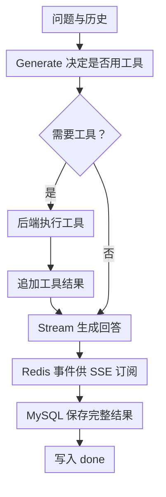

# MCP 工具调用

MCP 可以理解为后端调用工具的一套通信协议。本项目先让模型决定是否需要工具，再由后端执行查询，最后让模型根据结果回答。

当前工具包括天气、汇率、网页搜索和平台帖子查询。模型负责选择工具和参数，不直接访问数据库或外部服务。

## 1. 主服务和工具服务怎样配合

| 部分 | 职责 |
| --- | --- |
| AI 聊天服务 | 组织问题和历史，调用模型，执行工具调用流程 |
| MCP Client | 连接工具子进程，将工具说明转换为 Eino 可用的模型工具声明 |
| MCP Server | 注册工具，接收调用，执行具体查询并返回结果 |

主服务启动 `cmd/mcp-server` 子进程，通过 stdin/stdout 交换 JSON-RPC 消息。stdout 专用于协议，日志写入 stderr 和日志文件；主进程持续读取子进程 stderr，避免管道积压。

帖子查询使用子进程自己的 MySQL 连接池。`internal/pkg/ai/mcp/server.go` 是进程内服务实现，当前主服务使用的是独立 stdio 子进程入口。

## 2. 一次问题怎样调用工具

1. 前端调用 `POST /user/aichat/startGeneration`。后端保存提问并启动后台生成任务，返回任务编号。
2. 后台任务读取历史，按开关检索知识库，再选择模型。
3. `runMCPAgentFlow()` 从 `FilteredMCPToolBinding()` 获取已缓存的工具说明和调用映射；关闭联网搜索时移除 `web_search`。
4. 调用模型的 `Generate()`，一次性取得是否调用工具的决定。
5. 如果有工具调用，后端按顺序执行，将调用决定与工具结果追加到模型输入；没有工具调用则使用原来的问题与历史。
6. 调用 `streamChatModel()` 进行流式回答，正文片段写入 Redis；前端通过独立的 SSE 订阅接口接收。
7. 文本生成结束后，把非空的网页来源、帖子数据写成 Redis 事件，再将完整回答、来源、帖子与会话摘要一起提交 MySQL 事务。成功后写入 `done`，失败则记录 `error`。

不需要工具时，也会重新调用 `Stream()`，不会直接把工具决策阶段的整段文字作为最终回答。

## 3. 会调用几次模型

| 情况 | 调用次数 |
| --- | --- |
| 工具可用，模型决定不用 | 一次 `Generate` 决策，加一次 `Stream` 回答 |
| 工具可用，模型决定使用 | 一次 `Generate` 决策，执行工具，再一次 `Stream` 总结 |
| 没有可用工具或绑定失败 | 直接一次 `Stream` 普通回答 |
| 工具决策请求失败 | 该次请求已尝试，随后回退 `Stream` 普通回答 |

一次决策可以包含多个工具调用，执行这些工具不等于再次调用大模型。当前流程只进行一轮工具决策，不会反复循环调用工具直到模型结束。

单个工具执行失败时，错误信息作为工具结果交给模型；最终生成或保存失败时，不会发送正常完成信号。

## 4. 工具返回什么

| 工具名称 | 主要参数 | 用途 |
| --- | --- | --- |
| `get_weather` | `location` | 查询城市天气 |
| `get_exchange_rate` | `base_currency`、`target_currency` | 查询两种货币的汇率 |
| `web_search` | `query` | 通过 Tavily 搜索网页 |
| `get_discover_posts` | `keyword`、`limit` | 查询平台帖子 |

工具可返回供模型阅读的文本，以及网页来源、帖子卡片等结构化数据。后端从返回结果中分别提取这些内容；来源与帖子会保存到回答记录，加载历史时仍可展示。

帖子查询的 `_viewer_id` 由后端根据登录用户注入，覆盖模型提供的同名值，用于按用户身份过滤可见内容。

## 5. 初始化与配置

主服务启动时显式调用 `InitMCPClient()`：启动子进程、完成 MCP 握手、加载工具并校验声明，全部成功后发布缓存。握手和工具加载共用30秒超时，最多尝试3次，间隔2秒；失败的客户端先关闭再重试。

聊天请求通过 `GetMCPTools()` 或 `FilteredMCPToolBinding()` 读取缓存，不会每次重新启动子进程或刷新工具列表。初始化失败时，普通 AI 聊天仍可回退执行；主服务退出时调用 `CloseMCPClient()` 关闭子进程。

启动参数由环境变量决定：

| 环境变量 | 用途 |
| --- | --- |
| `MCP_SERVER_COMMAND` | 启动命令；未设置时使用 `go run ./cmd/mcp-server` |
| `MCP_SERVER_WORKDIR` | 子进程工作目录；未设置时使用当前目录 |

当前客户端不读取 TOML 的 `[mcpConfig]` 段。默认命令与相对配置路径要求工作目录为 `seekF-backend/`。

模型由 `[aiModelConfig]` 配置，支持 `deepseek`、`qwen`、`glm`、`glm-4v`、`qwen-local`，是否可用取决于配置和初始化结果。天气、汇率、网页搜索分别读取对应服务配置，密钥可通过相关环境变量覆盖。

## 6. 新增工具时需要做什么

1. 在职责对应的工具模块中定义名称、描述、参数和执行函数。
2. 在 `cmd/mcp-server/main.go` 注册工具。
3. 更新必要的配置，并由用户重启主服务，使新的子进程加载工具列表。

普通文本工具可以复用现有执行流程。如果需要像来源、帖子卡片一样返回专用结构化数据，还需在聊天服务和前端增加对应的提取、事件与展示处理，不能只注册工具。

相关流程还可参阅 [AI 聊天](AiChat.md) 和 [知识库 RAG](RAG.md)。
