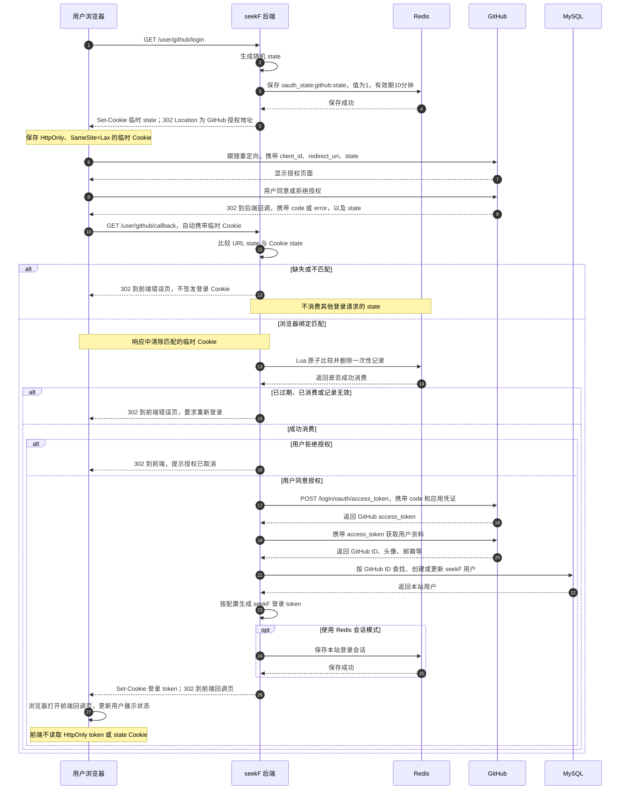

# GitHub OAuth 登录实现

## 概述

本文档介绍 seekF 项目中 GitHub OAuth 第三方登录的完整实现流程，包括后端接口、OAuth 认证流程、前端回调处理等。

## 目录结构

```
seekF-backend/
├── config/config.toml                    # OAuth 配置
├── internal/
│   ├── configs/configs.go                # 配置结构体定义
│   ├── controllers/user/auth_controller.go  # OAuth 控制器
│   ├── services/user_service/auth_service.go # OAuth 业务逻辑
│   ├── pkg/oauth/github.go               # GitHub OAuth 工具包
│   └── router/router.go                  # 路由定义

seekF-user/
├── app/pages/login.vue                   # 登录页（触发 GitHub 登录）
└── app/pages/oauth/github/callback.vue   # OAuth 回调页面
```

## OAuth 2.0 认证流程

### 流程图



### 三个凭证的严格区分

| 凭证 | 颁发者 | 持有者 | 生成时机 | 用途 |
|------|--------|--------|----------|------|
| `code` | GitHub | seekF后端（从URL参数获取） | 用户在GitHub点击授权后 | 一次性凭证，用于换取`access_token` |
| `access_token` | GitHub | seekF后端 | seekF用`code`向GitHub交换时 | 调用GitHub API获取用户信息 |
| `token` | seekF | 用户浏览器（Cookie） | seekF验证完用户身份后 | 用户访问seekF时的身份凭证 |

### 详细流程说明

**① 用户点击 GitHub 登录按钮**
- 前端跳转到 `GET /user/github/login`

**② 后端生成授权地址（生成 state）**
- 使用 `crypto/rand` 生成 16 字节随机数，编码为 32 位十六进制 `state`。
- Redis 保存 `oauth_state:github:<state>`，值为 `"1"`，有效期 10 分钟。
- 向当前浏览器设置 `oauth_state_github=<state>` 临时 Cookie，有效期 10 分钟，`HttpOnly=true`、`SameSite=Lax`，不设置 Domain。
- 返回 HTTP 302，`Location` 为 GitHub 授权地址，URL 携带 `state` 和 `redirect_uri`。

**③ 浏览器跳转到 GitHub 授权页面**
- URL 格式：`https://github.com/login/oauth/authorize?client_id=xxx&redirect_uri=编码后的后端回调地址&state=xxx&scope=xxx`
- 此时 `state` 由 seekF 后端生成，同时存在于授权 URL、当前浏览器的临时 Cookie，以及 Redis 的 key 中；它不是保密凭证，安全性依赖浏览器绑定和一次性消费

**④ 用户在 GitHub 页面点击 "Authorize" 同意授权**
- 用户确认授权 seekF 访问其 GitHub 基本信息

**⑤ GitHub 回调 seekF（生成 code）**
- GitHub 生成临时授权码 `code`（有效期约10分钟，只能使用一次）
- GitHub 重定向到 seekF 的回调地址：`http://localhost:8080/user/github/callback?code=AUTH_CODE&state=xxx`
- 此时 `code` 由 GitHub 颁发，通过 URL 参数传递给 seekF

**⑥ 浏览器直接访问后端回调，后端校验浏览器绑定**
- GitHub 通过重定向让浏览器访问后端；不是 GitHub 服务器直接调用 localhost，也不需要前端 JavaScript 再转发 code。
- 后端读取 URL 中的 `code`、`state`，以及浏览器自动携带的 `oauth_state_github` Cookie。
- 必须满足：URL state 与 Cookie state 都存在、格式正确，并且两者一致。跨浏览器或旧登录回调不匹配时直接拒绝，不删除新登录对应的 Cookie 或 Redis 记录。
- 匹配后，Redis Lua 原子比较该 key 的值是否为 `"1"`，只有一个请求能够成功删除并消费它；不存在、过期、已消费或值异常均拒绝。
- 对匹配当前浏览器的回调清除临时 Cookie，之后才兑换 code；有效的取消授权回调也会消费 Redis 记录并清除临时 Cookie。

**⑦ seekF 后端用 code 向 GitHub 换取 access_token**
- seekF 后端向 GitHub 发送请求：`POST https://github.com/login/oauth/access_token`
- 请求体包含：`client_id`、`client_secret`、`code`
- 此时 `code` 被消耗，换取到 `access_token`

**⑧ GitHub 返回 access_token**
- GitHub 验证 `code` 有效后，返回 `access_token`（对应授权用户的 GitHub 账号）
- `access_token` 由 GitHub 颁发，由 seekF 后端持有

**⑨ seekF 后端用 access_token 获取用户信息**
- seekF 后端向 GitHub API 发送请求：`GET https://api.github.com/user`
- 请求头携带：`Authorization: token {access_token}`
- GitHub 返回用户信息（头像、邮箱、昵称等）

**⑩ GitHub 返回用户信息**
- seekF 后端获取到用户的 GitHub ID、头像、邮箱等信息

**⑪ seekF 后端处理登录，生成 seekF token**
- 根据 GitHub ID 查找或创建 seekF 用户
- 生成 seekF 自己的 `token`（JWT 或 session）
- 将 `token` 写入 HttpOnly 登录 Cookie，Path 为 `/`，不设置 Domain，SameSite 为 Lax，Secure 按部署配置决定。
- 返回 HTTP 302，浏览器按 Location 跳到前端回调页面，URL 仅携带编码后的用户展示信息，不携带登录 token。
- GitHub access_token 只用于后端请求 GitHub API，不作为 seekF 登录凭证。

### CSRF 攻击与 state 防护

登录 CSRF 的风险是浏览器被登录成攻击者的账号，受害者随后输入的聊天、上传的资料等落入攻击者账号。受害者不需要事先登录 seekF。

如果完全没有 state 校验，攻击者可以用自己的 GitHub 身份授权，截取尚未过期且尚未兑换的 code，再诱导受害者访问：

```text
https://your-seekF.com/user/github/callback?code=攻击者的code
```

后端若直接处理这个 code，就可能通过 Set-Cookie 把攻击者账号的 seekF token 写入受害者浏览器。

仅校验“URL state 在 Redis 中存在”也不完整：攻击者能看到自己授权 URL 中的 state，可以将自己的 code 和 state 一起发给受害者。state 不是只有后端知道的秘密。

本项目现在核对两个独立来源：

```text
正常：浏览器Cookie state=A，GitHub回调URL state=A → Redis原子消费成功后继续登录
攻击：浏览器Cookie state=A，攻击链接URL state=B → 不匹配，拒绝
未发起登录：没有临时Cookie，即使攻击者state在Redis有效 → 拒绝
重复回调：URL和Cookie相同，但Redis记录已消费 → 拒绝
```

Cookie 证明当前浏览器之前发起了哪次登录，URL state 标识本次回调对应哪次登录；不能省略其中一个。HttpOnly 阻止脚本读取 Cookie，但不会阻止浏览器自动发送 Cookie，因此不能单独防 CSRF。

GitHub 和 Gitee 使用不同的 Redis 前缀和临时 Cookie；同一浏览器对同一平台重复发起登录，以最后一次临时 Cookie 为准，旧回调会被拒绝。此防护针对 OAuth 登录，不代替其他业务接口的 CSRF 防护。

## 代码实现

### 1. 配置与路由

`config/config.toml`：

```toml
[githubOAuthConfig]
clientID = ""
clientSecret = ""
redirectURL = "http://localhost:8080/user/github/callback"
frontendRedirectURL = "http://localhost:3000/oauth/github/callback"
proxyURL = "http://127.0.0.1:7890"
```

敏感凭证放入后端 `.env`：

```dotenv
GITHUB_OAUTH_CLIENT_ID=你的ClientID
GITHUB_OAUTH_CLIENT_SECRET=你的ClientSecret
USER_COOKIE_SECURE=false
ADMIN_COOKIE_SECURE=false
```

本地或服务器使用 HTTP 时设为 false；对外 HTTPS 部署时设为 true，包括 Nginx 提供 HTTPS、内部转发 HTTP 的情况。默认不配置相当于 false；Go 自己直接收到 TLS 请求时也会开启 Secure，不依赖未经校验的 X-Forwarded-Proto。管理端沿用既有 ADMIN_COOKIE_SECURE，用户端使用 USER_COOKIE_SECURE，两者独立。`.env` 在启动时加载，修改后需重启后端。

用户端登录和临时 OAuth Cookie 都保持 `HttpOnly=true`、`SameSite=Lax`、Path=`/`，不设置 Domain，默认仅绑定实际响应主机。临时 Cookie 名称分别为 `oauth_state_github`、`oauth_state_gitee`。删除时沿用相同名称、Path、Domain 和安全属性。

Lax 允许 GitHub/Gitee 返回 seekF 的顶层 GET 跳转携带临时 Cookie；不能设置 Strict 导致合法回调丢失 Cookie。Lax 也不能替代 state 比较。发起登录与后端回调必须使用同一个主机名，不能混用 localhost 和 127.0.0.1；部署时也必须同步修改平台和后端配置的回调地址。

路由保持不变：`GET /user/github/login`、`GET /user/github/callback`；Gitee 对应 `/user/gitee/login`、`/user/gitee/callback`。

### 2. Controller 与 Service 职责

- [AuthController](../internal/controllers/user/auth_controller.go)：发起登录时取得授权 URL 和 state，写入临时 Cookie，再返回 302；回调读取 URL 与 Cookie 两份 state，传给 Service。匹配当前请求的临时 Cookie 会被清除，失败不签发新登录 Cookie。
- [AuthService](../internal/services/user_service/auth_service.go)：生成平台独立的限时 state；恒定时间比较浏览器与 URL 状态，随后原子消费 Redis 记录；通过后才调用 OAuth 平台兑换 code、查找或创建用户并生成 seekF token。
- [Redis 工具](../internal/pkg/redis/redis_util.go)：`CompareAndDeleteString(ctx, key, expected)` 只负责通用的字符串比较和原子删除，不包含 OAuth 平台或 Cookie 逻辑。
- [OAuth 工具](../internal/pkg/oauth/github.go)：`oauth2.Config.RedirectURL` 读取配置，`AuthCodeURL` 自动将其编码为授权链接的 redirect_uri；`ExchangeAndGetUser` 接收请求 Context，兑换 token 并请求用户资料。
- [OAuth 常量](../internal/pkg/constants/oauth.go)：平台标识、Cookie/Redis 前缀、32 字符状态长度和 10 分钟有效期统一声明。

Service 的关键接口：

```go
GithubAuthURL(ctx context.Context) (authURL, state string, err error)
LoginByGithub(ctx context.Context, code, state, browserState string) (*LoginRespond, error)
GiteeAuthURL(ctx context.Context) (authURL, state string, err error)
LoginByGitee(ctx context.Context, code, state, browserState string) (*LoginRespond, error)
CancelOAuthLogin(ctx context.Context, provider, state, browserState string) error
```

Redis 检查与消费使用一个 Lua 脚本：

```lua
if redis.call('GET', KEYS[1]) == ARGV[1] then
  return redis.call('DEL', KEYS[1])
end
return 0
```

只有脚本返回 1 才继续。不能用分开的 GET 和 DEL，否则并发回调可能同时校验成功。无效的浏览器绑定不会消费别人的 state；取消授权也必须先校验绑定。

### 3. 前端处理

前端登录按钮仍通过 `window.location.href` 访问后端 `/user/github/login`，无需读取或写入 state Cookie。授权成功后，后端设置登录 Cookie，再重定向到前端 `/oauth/github/callback?user=...`；前端展示用户信息。登录凭证由浏览器随接口请求自动携带，前端 JavaScript 无法从 HttpOnly Cookie 中读取它。

## GitHub OAuth App 配置

### 1. 创建 OAuth App

1. 访问 [GitHub Developer Settings](https://github.com/settings/developers)
2. 点击 "New OAuth App"
3. 填写信息：
   - **Application name**: seekF
   - **Homepage URL**: `http://localhost:3000`
   - **Authorization callback URL**: `http://localhost:8080/user/github/callback`

### 2. 获取凭证

创建完成后获取：
- **Client ID**: 填入 `config.toml` 或 `.env`
- **Client Secret**: 填入 `.env`（敏感信息）

## 安全措施

1. 浏览器绑定：URL state、临时 Cookie state 必须一致，缺失或跨浏览器拒绝。
2. 一次性消费：Redis Lua 比较并删除，过期、重复及并发请求最多一个成功。
3. Cookie 属性：HTTP 开发 Secure=false，HTTPS 部署 Secure=true；HttpOnly、SameSite=Lax、host-only，设置与删除保持一致。
4. 平台隔离：GitHub/Gitee 的 Cookie 与 Redis key 分开，不允许跨平台复用。
5. 取消授权：验证绑定后清除 Cookie 并消费记录，不兑换 code、不生成 seekF token。
6. 外部请求失败：state 已消费、临时 Cookie 已清理，需重新点击登录，不重复使用原回调地址。
7. 业务日志不主动打印 code、state、OAuth access_token、Client Secret 或登录 token。回调 URL 本身含临时参数，部署时还应对 Nginx/Gin 等访问日志中的这些查询参数脱敏。

## 错误处理

| 错误场景 | 处理方式 |
|---------|---------|
| 用户取消授权 | GitHub 返回 `error` 参数，提示"授权已取消" |
| State 缺失或浏览器不匹配 | 不兑换 code、不写登录 Cookie，不消费其他登录请求的 Redis 记录 |
| State 过期、已使用或值异常 | 原子消费失败，要求重新发起登录 |
| Code 换取 Token 失败 | 返回错误信息到前端 |
| 获取用户信息失败 | 返回错误信息到前端 |

## 调试日志

```go
zlog.Info("GitHub 授权被拒绝: " + errMsg)
zlog.Error("生成 GitHub 授权地址失败: " + err.Error())
zlog.Error("GitHub 登录失败: " + err.Error())
zlog.Error("序列化 GitHub 登录用户信息失败: " + err.Error())
```

## 常见问题

### 1. 回调地址不匹配

确保 `config.toml` 中的 `redirectURL` 与 GitHub OAuth App 配置一致。

### 2. 代理问题

如果当前网络访问 GitHub API 需要代理，可以配置 `proxyURL`；服务器无需代理时设为空，不要沿用开发电脑的代理端口：

```toml
proxyURL = "http://127.0.0.1:7890"
```

### 3. 邮箱为空

GitHub 用户可能设置了邮箱隐私，需要单独调用 `/user/emails` API 获取。

## 相关依赖

依赖版本以项目 `go.mod` 为准，主要使用 `golang.org/x/oauth2`、Gin 和 go-redis。

## 参考资料

- [GitHub OAuth Documentation](https://docs.github.com/en/apps/oauth-apps/building-oauth-apps/authorizing-oauth-apps)
- [golang.org/x/oauth2](https://pkg.go.dev/golang.org/x/oauth2)
