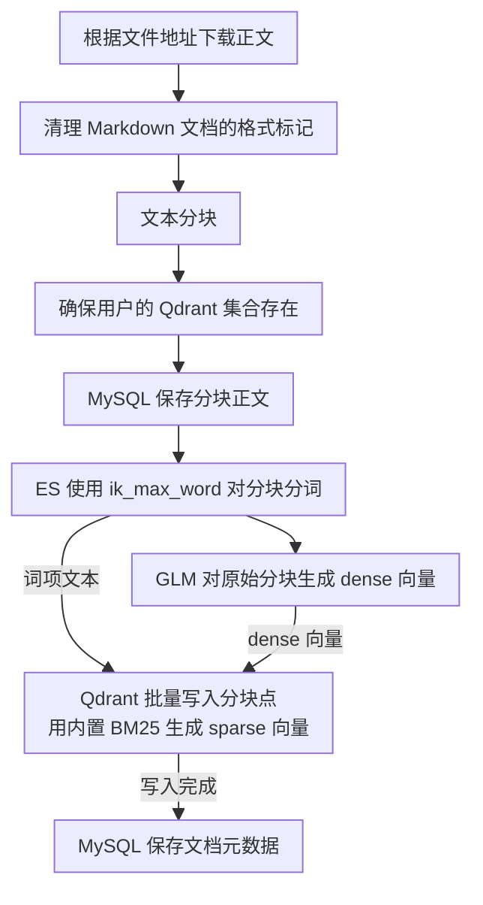
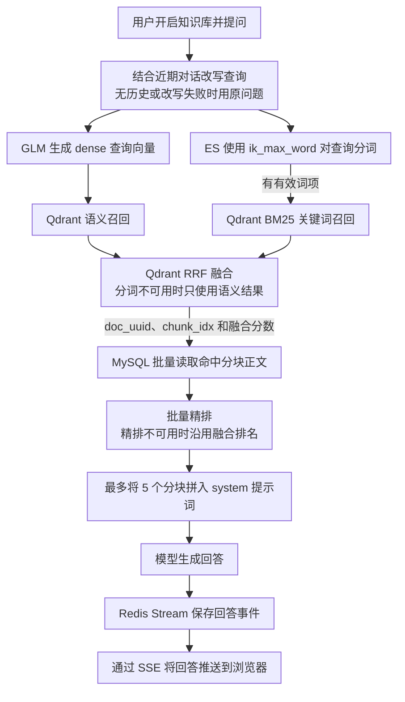

# seekF 项目 RAG 实现详解

知识库使用 **GLM Embedding 稠密向量、Qdrant 内置 BM25 稀疏向量和 RRF 融合**。在线问答使用 GLM 对话模型改写查询，通过阿里云百炼 `qwen3-rerank` 精排候选。Go 后端复用 Elasticsearch 的 IK 分词器处理中文，词项编号和 BM25 权重由 Qdrant 生成。

主服务启动时依次显式初始化配置、日志、MySQL、Redis、ES、Qdrant和AI模块。`InitRAG()`创建Embedding包装对象与分块器，不发送远程向量化请求；`GetRAG()`只读取实例。ES初始化包含服务探测和搜索索引准备，Qdrant初始化通过健康检查确认响应。MySQL或Redis初始化失败会阻止主服务启动；ES、Qdrant初始化失败时记录告警，相关功能通过请求错误或既定降级流程处理。

## 1. 整体流程

### 文档入库

### 提问与生成

| 模块 | 职责 | 代码 |
| --- | --- | --- |
| KnowledgeService | 下载、入库、删除、回查正文 | [knowledge_service.go](../internal/services/user_service/knowledge_service.go) |
| RAG | 组合分块、GLM Embedding 和混合检索 | [init.go](../internal/pkg/ai/rag/init.go) |
| TextSplitter | 文档分块 | [splitter.go](../internal/pkg/ai/rag/splitter.go) |
| PrepareBM25Text | 调用ES的IK分词，文档与问题使用相同分析器 | [sparse.go](../internal/pkg/ai/rag/sparse.go) |
| AnalyzeText | 调用通用ES文本分析接口 | [es_util.go](../internal/pkg/db/es_util.go) |
| Embedding | 调用 GLM Embedding API | [embedding.go](../internal/pkg/ai/rag/embedding.go) |
| QdrantUtil | BM25 推理、向量存储、RRF、索引检查和迁移 | [qdrant_util.go](../internal/pkg/db/qdrant_util.go) |
| AIChatService | 选择上下文、生成并缓存回答事件 | [aichat_service.go](../internal/services/user_service/aichat_service.go) |
| 常量 | 向量字段、BM25 参数、上下文数量 | [ai.go](../internal/pkg/constants/ai.go) |

## 2. 文档分块与词项切分

分块决定一次检索返回哪段正文；词项切分用于 BM25 关键词匹配，两者是不同步骤。

### 文档分块：TextSplitter

默认每块最多500个Unicode字符，相邻块保留最多50个尾部字符作为上下文重叠；中文、英文字符和emoji均按Unicode字符计数。

Service根据文件类型，对Markdown调用rag.NormalizeMarkdown进行预处理；该函数与分块器位于splitter.go，保留标题文字与段落空行，清理代码围栏和分隔线。TXT正文直接进入SplitText。分块器统一换行符，按空行组织段落，段内普通换行合并为空格。接近块长上限时，优先在窗口后半段选择段落边界，其次选择中文或英文句末；超长句子或无句末标点的段落按字符上限切分。

所有截取均在字符边界进行，空白正文不生成分块。重叠部分在空白清理后可能少于50个字符。块长是字符数限制，Embedding接口仍按所配置模型的输入约束处理正文。

### BM25 预处理：PrepareBM25Text

文档分块和用户问题都通过 PrepareBM25Text 调用 ES 的文本分析接口：

~~~http
POST /_analyze
Content-Type: application/json
Accept: application/json

{
  "analyzer": "ik_max_word",
  "text": "人工智能与向量数据库"
}
~~~

ES 使用已安装的 IK 插件及其词典返回 tokens。后端读取 token 字段，去除空词项、转小写，保留原有顺序和重复词项，再用空格连接交给 Qdrant。知识库正文仍由 MySQL 保存，调用分析接口不需要把正文写入 ES 索引。

IK 分词示意（用于说明细粒度词项及重复词频；具体输出由插件和词典决定）：

~~~text
人工智能与向量数据库
→ 人工智能 人工 智能 能与 向量 数据库 数据 库

人工智能 人工智能
→ 人工智能 人工 智能 人工智能 人工 智能

错误HTTP500重试 E_CONN_42 useApi
→ 错误 http500 http 500 重试 重 试 e_conn_42 e conn 42 useapi
~~~

ik_max_word 采用细粒度分词，会同时产生完整词和较短词项。重复出现的词不做全局去重，以便 BM25 计算词频。词典通过 IK 插件配置管理，文档入库与问题查询显式指定同一个分析器。

每次分词最多等待5秒，继承上层请求的取消信号。上传时先完成全部分块的分词，再调用 GLM；ES 分词失败时返回错误。查询分词失败时记录中文日志，使用 dense 语义候选继续检索。

## 3. 两种向量如何生成

### Dense：GLM Embedding

Go 通过 EmbedTexts 调用 POST {GlmBaseUrl}/embeddings。请求示意：

~~~json
{
  "input": ["第一个分块正文", "第二个分块正文"],
  "model": "配置的 GlmEmbeddingModel"
}
~~~

模型、地址和密钥读取配置，每批最多16条文本，响应按 index 还原顺序。当前集合创建时指定 dense 为2048维、距离为 Cosine，因此模型实际输出必须与2048维一致。

入库的 Dense 向量使用原始分块生成，查询的 Dense 向量使用改写结果或回退后的原始问题生成。

### Sparse：Qdrant 内置 BM25

Go 将预处理文本封装为 Document，写入使用 NewVectorDocument，查询使用 NewQueryDocument：

~~~go
document := &qdrant.Document{
    Model: constants.KnowledgeBM25Model, // qdrant/bm25
    Text:  text, // PrepareBM25Text 的输出
    Options: qdrant.NewValueMap(map[string]any{
        "language": "none",
        "k":        constants.KnowledgeBM25K,
        "b":        constants.KnowledgeBM25B,
        "avg_len":  constants.KnowledgeBM25AvgLen,
    }),
}
~~~

Qdrant 服务端将词项映射为编号，计算考虑词频饱和、长度归一化的权重，保存为 indices 和 values。集合启用 IDF modifier，由 Qdrant 维护集合内的词项文档频率，并在检索评分时应用 IDF；Go 不额外乘一次 IDF。

| 参数 | 当前值及含义 |
| --- | --- |
| 模型 | qdrant/bm25 |
| language | none，禁用默认英文词干及停用词处理 |
| k | 1.2，控制词频饱和 |
| b | 0.75，控制长度归一化 |
| avg_len | 256，IK词项数量的固定平均长度估计，不是实时语料平均值 |

文档和问题使用相同预处理与参数。调整IK词典、分析器、预处理、权重参数或平均长度估计时，需要重新处理已有稀疏向量，仅修改查询端会导致不一致。

预处理后没有词项的分块只存 dense；没有词项的问题只使用 dense 候选。稀疏向量链路不调用 GLM。

## 4. 数据存储与标识

### MySQL

knowledge 保存文档元数据，包括 uuid、user_id、file_name、file_url、file_type、chunk_count、created_at 等。

knowledge_chunk 保存分块正文：

| 字段 | 用途 |
| --- | --- |
| doc_uuid | 关联知识库文档 |
| chunk_idx | 分块序号，从0开始 |
| content | 分块正文 |
| created_at | 创建时间 |

完整文件由 file_url 指向；Qdrant payload 不保存正文，检索后通过 doc_uuid + chunk_idx 从 MySQL 读取。

### Qdrant

每个用户使用独立集合 knowledge_{userId}，名称由后端根据用户身份构造。

| 字段 | 当前实现 |
| --- | --- |
| id | 文档ID与分块序号生成的确定性 UUID |
| vector.dense | GLM 生成的2048维语义向量 |
| vector.sparse | Qdrant BM25 生成的稀疏向量，启用 IDF |
| payload.doc_uuid | 文档ID |
| payload.chunk_idx | 分块序号 |

字段名统一使用 constants.KnowledgeDenseVector 和 constants.KnowledgeBM25Vector，实际分别为 dense、sparse。sparse 字段存储 BM25 词项权重。

点 ID 的生成方式：

~~~go
name := fmt.Sprintf("%s-chunk-%d", docUUID, chunkIndex)
pointID := uuid.NewSHA1(uuid.NameSpaceURL, []byte(name)).String()
~~~

文档 ID 以 K 开头，Qdrant 点 ID 是标准 UUID，两者不同。点 ID 当前不含文档版本；同一文档、同一序号重复写入会更新对应点。

## 5. 混合检索与 RRF

查询调用链：

~~~text
KnowledgeService.Search
→ RAG.HybridSearch
→ GLM EmbedTexts + ES IK分词
→ QdrantUtil.HybridSearch
→ dense / sparse prefetch
→ Qdrant 内置 RRF
→ MySQL 批量查询正文
~~~

融合配置为：

~~~go
Query: qdrant.NewQueryFusion(qdrant.Fusion_RRF),
~~~

RRF 按各路名次累计贡献，可用 Σ 1/(k + rank) 理解，具体排名起点及参数取服务端实现。项目没有自己实现融合算法。RRF 的平滑参数 k、BM25 的词频参数 k、返回数量 TopK 是不同概念。

AI 对话的两路检索各取最多 10 个分块，融合后返回最多 10 个候选。融合分数反映分块在两路检索中的排名贡献。

### 查询改写与候选精排

启用 `queryRewriteModel` 且有历史文本时，后端把当前问题和最近最多 3 轮文本对话发给 GLM，请它补全指代并返回一条独立查询。改写后的查询用于两路召回和精排。改写失败或超过 2 秒时用原始问题检索。生成最终回答时始终使用原始问题。

从 MySQL 取回候选分块正文后，后端把查询和整批正文提交到百炼文本重排序接口。后端按返回的相关性分数排序，通过候选下标取出最多 5 个分块。仅命中一个分块时也会请求精排分数。精排失败、超时或返回无效时，按 RRF 排名选取上下文。精排最多等待 2 秒。

`[aiModelConfig]` 中的 `queryRewriteModel` 默认为 `glm-4.7-flash`，使用现有 GLM 凭证及地址。`rerankModel` 默认为 `qwen3-rerank`，使用 `QWEN_API_KEY` 和 `QWEN_BASE_URL` 的服务域名访问百炼原生精排接口。模型名可分别通过 `QUERY_REWRITE_MODEL` 和 `RERANK_MODEL` 覆盖，留空可关闭对应步骤。

## 6. 回答生成与失败处理

开启知识库后，AIChatService 把选中正文拼入 system 提示词，要求模型参考资料回答；没有相关信息时允许忽略资料。ES分词失败时记录中文 Warn 日志，仅使用语义候选参与RRF排名；整体检索失败时沿用普通 AI 回答流程。

聊天回答的「参考文档」仅收录本轮送入模型且 Rerank 相关性分数严格大于 `0.6` 的分块，按文件归并。每份文档展示文件名和最靠前的命中摘录。点击条目可预览当前账号仍有权限访问的文档，并展开命中详情查看各分块的序号、摘录和置信度。界面将 Rerank 相关性分数显示为保留两位小数的百分比。没有符合条件的分块时，回答省略这个入口。引用随回答保存，历史会话展示当时保存的引用。

参考文档预览按入库时的规则整理正文，并将与已保存分块一致的命中区间高亮。相邻分块共用的文字只展示一次。无法核对任何命中位置时，预览显示原始内容。知识库列表中的普通预览直接读取原始内容。

模型回答事件写入 Redis Stream，SSE 订阅端读取并发送给浏览器，支持断线回放。Redis Stream 保存的是回答事件，不是 Qdrant 索引。

上传和删除按以下顺序访问 MySQL 与 Qdrant：

- 上传先保存分块，再写向量，最后保存文档元数据。向量写入失败时尝试删除已保存的分块，并向调用方返回错误。
- 删除先校验归属，再删除向量、分块及文档记录；向量或分块删除失败时会记录日志并继续后续步骤。
- 查询跳过无法在 MySQL 找到正文的命中并记录日志。

## 7. 稀疏索引配置

sparse 字段保存 BM25 词项权重，并启用 IDF modifier。词项文档频率由 Qdrant 按用户集合统计，文档与查询使用相同的 IK 分词规则和 BM25 参数。

MigrateKnowledgeBM25 接收分块标识与预处理文本，先核对集合点数，再按确定性 ID 检查点存在。每批最多100块，只更新 sparse 向量并等待写入完成；dense 向量与分块关联保持原值，同一批可以重复提交。

## 8. 问题排查

| 现象 | 检查方向 |
| --- | --- |
| 稀疏向量查询报错 | 检查 sparse 字段、IDF配置及Qdrant的BM25推理参数 |
| ES分词失败 | 检查ES连接、IK插件、ik_max_word分析器、权限及5秒超时 |
| 中文关键词命中差 | 对比两端IK分析器、词典版本与返回词项 |
| 维度不匹配 | 检查 GLM 模型输出与 dense 的2048维配置 |
| 点 ID 格式错误 | 使用 generateChunkID 生成标准 UUID，不直接拼接 K 前缀文档ID |
| 有向量却没有正文 | 检查 MySQL 的 doc_uuid 与 chunk_idx |
| 回答使用无关资料 | 检查候选正文及两路排名，确认注入提示词的资料与问题匹配 |
| 分块长度与预期不一致 | 检查字符上限、段落与句末位置，以及尾部重叠的取值 |
