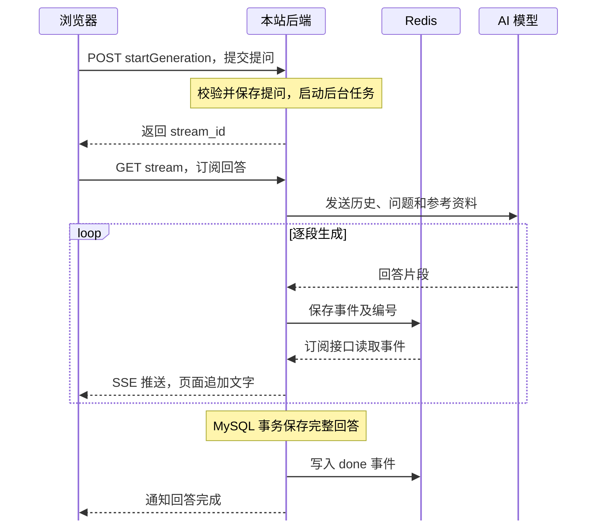
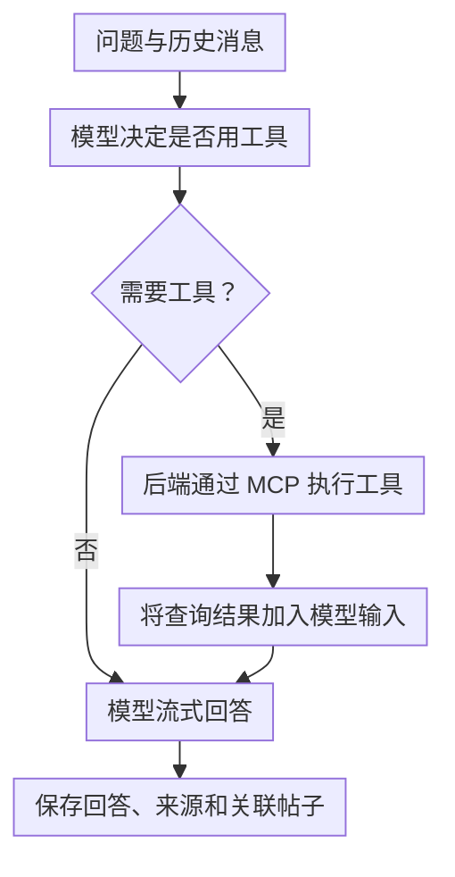
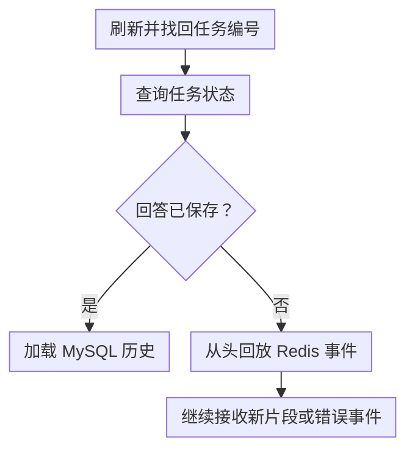

# AI 聊天

AI 聊天的主要流程是：**保存提问 → 读取历史和参考资料 → 调用模型 → 逐段显示回答 → 保存完整回答**。浏览器只请求本站后端，模型密钥由后端保管。

## 1. 一次提问怎样变成回答

发送消息和接收回答分成两个请求：

1. **启动任务**：前端提交问题、模型和功能开关。后端检查会话归属、模型是否可用及并发限制，保存用户消息，返回本次回答的 `stream_id`。
2. **订阅回答**：前端拿着 `stream_id` 建立 SSE 连接。后端生成任务把回答片段写入 Redis，订阅接口持续读取并推送给浏览器。
3. **保存结果**：模型输出完成后，后端在同一个 MySQL 事务中保存完整回答、搜索来源、关联帖子和会话摘要。提交成功后，才写入 `done` 完成事件。

这两步请求让生成任务与浏览器连接分开：页面刷新或连接断开，只会停止接收，不会立即取消正在生成的回答。



用户消息和 AI 回答分开保存。因此，生成失败时提问仍在历史中，但未完成的回答不会被当成完整回答保存。此链路直接写 MySQL，不经过 Kafka；AI 评论回复属于另一条业务链路。

## 2. 模型为什么能接着上文回答

模型不会自动记住本站之前的聊天。每次生成，后端都从 MySQL 读取最近 **100条消息**，按时间顺序组织成输入，再加上当前问题。当前提问已经保存过，构建输入时会去重，避免发给模型两次。

| 消息角色 | 给模型看的内容 |
| --- | --- |
| `system` | 助手规则、当前时间，以及检索到的知识库内容等 |
| `user` | 用户历史提问和当前问题；多模态模型还可接收图片 |
| `assistant` | AI 之前的回答，以及本轮工具调用决定 |
| `tool` | 工具实际查询到的结果 |

例如，用户先说“我准备去北京”，再问“那里天气怎么样”，后端把两轮对话一起传给模型，模型才能理解“那里”指北京。历史条数有限，实际可用输入还受所选模型的长度限制。

模型池在后端启动时创建并复用客户端，提供 `deepseek`、`qwen`、`glm`、`glm-4v`、`qwen-local` 这些模型类型，是否可用取决于配置和初始化结果。客户端负责访问模型服务，聊天记录保存在 MySQL。

图片消息先上传 OSS，再将图片地址和文字交给模型；哪些模型支持图片，由 `[aiModelConfig]` 的 `multimodalModels` 配置判断。

## 3. 工具调用：先查资料，再让模型回答

MCP 是后端与工具服务之间的通信协议。主服务启动独立的 `cmd/mcp-server` 子进程，通过标准输入、输出交换请求和结果；浏览器不直接连接这个子进程。

| 工具 | 作用 | 主要参数 |
| --- | --- | --- |
| `get_weather` | 查询天气 | `location` |
| `get_exchange_rate` | 查询汇率 | `base_currency`、`target_currency` |
| `web_search` | 通过 Tavily 搜索网页 | `query` |
| `get_discover_posts` | 查询平台帖子 | `keyword`、`limit` |

关闭“联网搜索”只会从本轮工具列表中移除 `web_search`，其他工具仍可使用。帖子工具的用户身份由后端注入，用于过滤当前用户不能访问的内容。

工具调用分两步：

1. **决定查什么**：后端把问题和工具说明交给模型，调用 `Generate()`，一次性取得工具调用决定。
2. **生成回答**：如果需要工具，后端执行工具，再把结果交给模型调用 `Stream()`，逐段输出回答；不需要工具则直接进入普通流式回答。



例如“北京今天的天气”，模型可选择天气工具，后端实际查询后，模型根据结果组织回答。模型负责决定工具及参数，具体接口由工具执行。

工具列表获取、绑定或决策阶段失败时，代码会回退到普通流式回答；单个工具执行失败时，会把失败信息作为工具结果交给模型。最终生成、事件保存或数据库写入失败，则返回错误，不标记正常完成。

网页来源和帖子卡片作为独立事件发送。当前实现是在最终文本流生成后发送这些结构化数据，不能假定来源一定先于正文到达。完整回答保存时，网页来源保留标题和 URL，关联帖子也会保存，刷新后可从历史加载。

## 4. 知识库：把用户文档作为参考资料

RAG（检索增强生成）可以理解为：**先从用户自己的文档中找相关段落，再让模型参考这些段落回答**。它不会把文档训练进模型。

文档入库时，系统将正文切块，每块最多500个 Unicode 字符，尾部重叠最多50个字符。正文存 MySQL，检索向量存 Qdrant，按 `knowledge_用户ID` 隔离。

打开“知识库”后，每次提问按以下步骤处理：

1. 根据问题做语义检索，并结合 ES 的 IK 分词进行 BM25 关键词检索。
2. Qdrant 融合两路排名，先返回最多10个相关文档片段，再取排名前5个作为模型的参考资料；不足5个时使用实际返回的片段。
3. 从 MySQL 取得对应正文，放入本轮 `system` 消息，让模型参考回答。

语义检索寻找“意思接近”的内容，关键词检索寻找“词语匹配”的内容。融合分数用于排序，不是相似度百分比。ES 分词失败时只使用语义检索；聊天中的知识检索失败或无结果时，继续普通回答。

知识库开关和联网搜索开关可以同时开启：前者提供个人文档资料，后者允许模型通过工具查询网页。

## 5. SSE、Redis 和刷新恢复

### 回答怎样一点点显示

SSE 是一次持续返回数据的 HTTP 响应。模型每生成一段文字，后端记录并推送一条事件，前端把它追加到消息中，所以用户能看到逐段输出。

前端使用 `fetch + ReadableStream` 接收 SSE，手动解析事件。当前启动任务是 POST 表单请求，订阅回答是单独的 GET 请求。

事件示例（编号仅用于说明格式）：

```text
id: 1000-0
event: delta
data: {"content":"你好"}

id: 1001-0
event: delta
data: {"content":"，有什么可以帮你？"}

id: 1002-0
event: done
data: {"message_id":"M示例消息ID"}

```

| 事件 | 含义 |
| --- | --- |
| `start` | 任务身份、会话及消息编号等信息 |
| `delta` | 一段回答文字 |
| `sources` | 网页搜索来源 |
| `posts` | 关联帖子 |
| `heartbeat` | 任务仍在运行 |
| `done` | 完整回答已经保存 |
| `error` | 生成或保存失败 |

数据通过 JSON 编码，换行和引号由编码器处理。前端按空行划分完整 SSE 事件，不能把一次网络读取当成一条完整消息。

### 刷新为什么还能继续接收

Redis Stream 保存本次回答的事件及递增编号。每个订阅连接独立读取，不会因为一个页面读过，其他页面就读不到。

- **网络短暂断开**：前端带上最后处理的事件编号 `after` 重连，只接收后续事件，并过滤重复编号；只重试订阅，不重新提交问题。
- **整页刷新**：前端从当前标签页的 `sessionStorage` 找回任务编号，先查询任务状态。回答已保存则加载 MySQL 历史；仍在生成则从 `0-0` 回放已有事件，再接收新事件。
- **缓存过期或无权访问**：接口明确报错；已保存的回答仍可通过会话历史查看。关闭标签页会丢失该标签页的恢复记录。



生成任务最长运行 **15分钟**，每 **5秒** 写一次心跳。事件缓存每次写入都会续期 **30分钟**；超过 **30秒** 没有新事件等情况会被识别为中断。Redis 用于短期回放，MySQL 用于长期历史。

浏览器断开不等于后端任务停止，但后端进程退出会打断生成。Redis 能回放已经记录的事件，不能让模型从中断位置重新生成。任务失败或中断时，页面明确提示，需要用户重新发送问题。

## 6. 常用接口

以下接口均需登录，路径以 `/user/aichat` 为前缀。仓库当前配置使用 Cookie 中的 token 做 Redis 会话认证。

| 方法与路径 | 用途及主要参数 |
| --- | --- |
| `POST /createSession` | 创建会话，JSON：`model_type` |
| `POST /getSessionList` | 会话列表，JSON：`page`、`page_size` |
| `POST /getMessageHistory` | 历史消息，JSON：`session_id`、`page_size`、`cursor`、`direction`；`prev` 查更旧，`next` 查更新 |
| `POST /startGeneration` | 提交问题，启动调用 AI 模型的后台任务；返回 `stream_id` 等任务信息。FormData 参数见下表 |
| `GET /streamInfo` | 查询已有回答任务的状态，返回生成中、已保存、失败或中断等信息，不返回回答正文；参数：`session_id`、`stream_id` |
| `GET /stream` | 持续接收已有任务的文字片段、来源和完成等 SSE 事件；参数：`session_id`、`stream_id`、`after` |
| `POST /deleteSession` | 删除会话，JSON：`session_id` |
| `POST /asr` | 上传录音，表单字段 `file`，以 SSE 返回语音识别结果 |
| `POST /tts` | 文字转语音，JSON：`content`、可选 `voice`，返回 PCM 音频流 |

### 三个回答接口怎样配合

**开始调用 AI 模型的是 `POST /startGeneration`。** 它校验参数、保存提问后，启动后台任务；任务构建上下文，再调用模型决定是否使用工具及生成回答。接口返回的是任务编号，不必等完整回答生成。`createSession` 只创建会话，不发起模型推理；`streamInfo` 和 `stream` 都只读取已有任务，不会重新提问或重新调用模型。

| 场景 | 调用顺序 |
| --- | --- |
| 用户发送新问题 | `startGeneration` 获取任务编号 → `stream` 接收回答 |
| SSE 断线后重连，页面还开着 | 用原任务编号和内存中的 `after` 再请求 `stream`，接收后续事件 |
| 刷新页面后恢复 | 用保存的任务编号请求 `streamInfo`；已保存则加载消息历史，否则订阅 `stream` 回放已有事件并接收后续内容或错误 |

**`streamInfo` 查哪些数据？** 先从 Redis 取得任务信息并校验归属，再查询 MySQL，确认完整回答是否已保存；尚未保存时，根据 Redis 最后事件和心跳判断运行状态。因此，Redis 保存的片段已经齐全，也不代表回答已经成功入库。

**`stream` 怎样持续返回？** 后端在同一条 HTTP 连接中循环调用 Redis `XREAD`：每次从 `after` 之后读取事件，没有新事件时最多等待1秒，返回后继续读；有事件就写入 SSE 并刷新给浏览器。收到 `done` 或 `error` 后结束订阅。

三个查询参数的含义：

| 参数 | 含义 |
| --- | --- |
| `session_id` | 会话编号，一个会话中可以多次提问 |
| `stream_id` | 某一次回答的任务编号，由 `startGeneration` 返回 |
| `after` | 最后一条已处理事件的编号，只用于 `stream`；从该编号之后继续读取，不传或为 `0-0` 时从头回放 |

`after` 在前端订阅函数和后端当前请求中各有一份内存变量，随事件处理更新。单纯断网不会清空页面内存，所以可以带上原游标重连；整页刷新会清空它，前端从 `sessionStorage` 找回 `stream_id`，重新从 `0-0` 回放。

### 启动生成的表单参数

`startGeneration` 的主要表单参数：

| 参数 | 用途 |
| --- | --- |
| `session_id` | 必填，会话编号 |
| `model_type` | 必填，选择模型类型 |
| `content` | 提问文字 |
| `image` | 可选图片文件，上传后由后端取得地址 |
| `image_url` | 已有图片地址；图片能否作为输入取决于模型配置 |
| `use_knowledge` | 是否检索用户知识库 |
| `use_web_search` | 是否允许网页搜索工具 |

文字和图片至少提供一种。启动成功返回 `stream_id`、`session_id`、`model_type`、AI 回答的 `message_id`、提问的 `user_message_id` 及状态。任务状态包括 `running`、`finished`、`error`、`interrupted`；回答缓存缺失返回 HTTP `410`，无权读取返回 `403`。

语音识别与语音合成使用各自的接口和响应格式，不共用上述回答事件回放流程。

## 7. 配置和代码位置

模型参数位于 `config/config.toml` 的 `[aiModelConfig]`，包含模型名称、API 地址和多模态模型列表。`.env` 加载的非空环境变量可覆盖相应配置，例如 `DEEPSEEK_API_KEY`、`QWEN_API_KEY`、`GLM_API_KEY`、`QWEN_LOCAL_BASE_URL`。

MCP 子进程命令和工作目录分别读取 `MCP_SERVER_COMMAND`、`MCP_SERVER_WORKDIR`，未设置时使用 `go run ./cmd/mcp-server` 和当前目录；当前客户端不读取 TOML 的 `[mcpConfig]`。天气、汇率、网页搜索分别使用相应的外部服务密钥。运行后端和默认 MCP 子进程时，工作目录应为 `seekF-backend/`，以便读取配置和找到入口。

| 代码位置 | 主要职责 |
| --- | --- |
| `internal/controllers/user/aichat_controller.go` | 启动任务、查询状态和 SSE 推送 |
| `internal/services/user_service/aichat_service.go` | 保存提问、组织上下文、调用模型与工具、记录事件、保存回答 |
| `internal/pkg/ai/model_pool.go` | 初始化并提供模型客户端 |
| `internal/pkg/ai/mcp/client.go`、`cmd/mcp-server/` | MCP 子进程连接与工具注册 |
| `internal/services/user_service/knowledge_service.go`、`internal/pkg/ai/rag/` | 知识库检索 |
| `internal/pkg/constants/ai.go` | 生成超时、事件缓存和心跳等常量 |
| `seekF-user/app/composables/useAIChat.js` | 发起生成、解析 SSE、断线重连 |
| `seekF-user/app/pages/aichat/index.vue` | 消息展示、任务编号保存和刷新恢复 |
