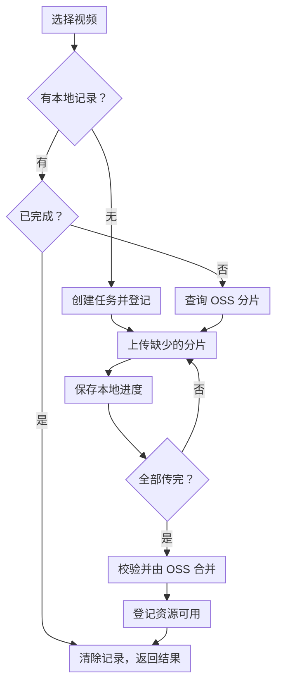
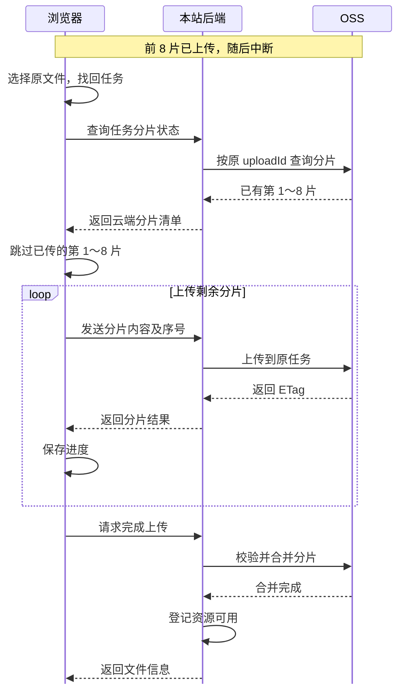
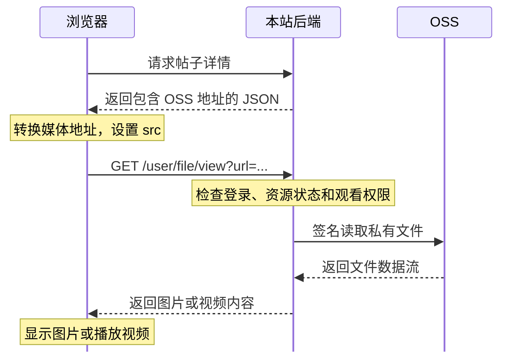

# 上传：断点续传与私有 OSS

文件通过 **浏览器 → 本站后端 → OSS** 上传，实际内容保存在 OSS。图片使用普通上传，一次发送完整文件；发现页视频使用分片上传，支持暂停和断点续传。浏览器不持有 OSS 密钥。

## 视频断点续传

### 基本原理：上传过的分片不用重传

浏览器用 `File.slice()` 把视频切成小块，默认每片 **5 MiB**，按顺序逐片上传。每片经过后端校验后交给 OSS 保存，全部上传成功后，再由 OSS 合并成完整视频。

例如，100 MiB 视频分成 20 片，前 8 片上传成功后断网。恢复时先查询 OSS，确认已有前 8 片，再从第 9 片继续。若第 9 片只传了一半就中断，这一片需要重新上传。

### 谁保存什么

| 位置 | 保存内容 | 作用 |
| --- | --- | --- |
| 用户设备 | 原视频文件 | 为尚未上传的分片提供内容 |
| 浏览器 localStorage | 上传任务号、文件路径、分片大小、已传分片记录等 | 刷新后找回原上传任务，不保存视频内容 |
| MySQL 的 `file_asset` 表 | 任务归属、文件大小、资源状态等 | 防止操作他人任务，记录上传是否完成 |
| OSS | 已上传的分片及分片清单，完成后保存完整视频 | 续传时以 OSS 实际保存的分片为准 |

几个关键字段：

- `uploadId`：OSS 分配的本次分片上传任务号，续传时沿用它。
- `objectKey`：文件在 OSS 中的保存路径。
- `partNumber`：分片序号，从 1 开始。
- `ETag`：OSS 返回的分片标记，合并时用它和序号指定对应分片。

localStorage 按“用户ID + 文件名 + 文件大小 + 最后修改时间”查找任务。这是找回任务的线索，不是视频内容哈希；Redis 不保存这里的分片进度。

### 从开始上传到合并完成

1. **找任务**：选中视频后，前端检查 localStorage 是否有对应的上传记录。
2. **准备任务**：没有记录就让后端创建 OSS 分片任务，并登记 MySQL；有记录就先检查是否已经完成，未完成则查询 OSS 已有的分片。
3. **补传分片**：浏览器跳过 OSS 已确认存在的分片，只上传缺少的。每片成功后，将序号、ETag 和大小写入 localStorage。
4. **合并文件**：全部分片上传后，后端查询 OSS，核对分片序号、ETag 和总大小，再请求 OSS 合并。后端不需要把整个视频下载回来拼接。
5. **完成登记**：后端将资源改为“可用”，前端清除本地续传记录。上传完成后，仍需提交帖子才能完成发布。



后端分片接口支持 `discover_video` 和 `message_video`，前端续传组件目前用于发现页视频。发现页视频限定为 **不超过 500 MiB 的 MP4**；后端在初始化、首片上传和合并时分别检查文件信息、MP4 文件头与实际大小。

### 中断后怎么继续

**暂停不会删除任务。** 当前正在发送的分片通常会先完成，前端在下一片开始前停下。点击继续后，重新核对 OSS 分片再补传。

**刷新或关闭页面后，需要重新选择原视频。** localStorage 还保存着任务信息，但浏览器内存中的 File 对象已经消失。使用同一浏览器、同一站点、同一账号选择原文件，才能找回任务；更换浏览器或清除站点存储后，无法凭原记录自动续传。



**为什么恢复时要查 OSS，不能只看本地进度？** 某片可能已经上传成功，但响应在网络中丢失，本地来不及记下来。查询 OSS 后仍能找回这片，避免重复上传。

其他情况按以下规则处理：

| 情况 | 处理方式 |
| --- | --- |
| 分片上传失败 | 保留记录，用户重试时核对 OSS，再补传缺片 |
| 已合并，但完成响应丢失 | 先检查资源是否可用；必要时沿用原任务重试完成登记 |
| 原任务无法恢复 | 尝试恢复失败后，可初始化新任务重新上传 |
| 用户取消上传 | 清除本地记录，并请求后端取消 OSS 任务；本地清除不保证云端取消成功 |

未完成或未被有效作品引用的发现页资源，由后台每小时检查；超过七天未更新的资源可被清理，删除失败后继续重试。

## 发现页私有媒体如何展示

### 为什么不能直接打开 OSS 地址

ACL（访问控制列表）用于设置文件的访问权限。发现页图片、视频明确设置为私有：

```go
request.Acl = oss.ObjectACLPrivate
```

因此，浏览器直接打开原始 OSS 地址时，没有访问凭据，会收到 `AccessDenied`。后端配置了有读取权限的 OSS 凭据，所以仍然可以读取。

其他上传类别不单独设置对象 ACL，继承 Bucket 权限：Bucket 公共读时可匿名读取，Bucket 私有时也不能直接打开。发现页显式设置 `private`，不会随 Bucket 改成公共读而继承公开权限；实际访问还受其他授权策略影响。

### 页面怎样显示图片和视频

以图片为例，整个过程分为四步：

1. **获取地址**：前端请求帖子详情，后端返回 JSON，其中包含原始 OSS 图片地址。
2. **转换地址**：前端将地址转换为 `/user/file/view?url=编码后的OSS地址`，赋给 `` 的 `src`。
3. **读取文件**：浏览器自动请求这个接口。后端检查登录、资源状态和观看权限，通过后使用 OSS SDK 读取私有图片。
4. **返回内容**：后端把图片的二进制内容返回浏览器，浏览器解码后显示。

前端地址转换由 `app/utils/discoverAccess.js` 处理，简化示例如下：

```js
// 示例：将原始 OSS 地址转换为本站媒体接口地址。
const src = apiBase.replace(/\/$/, '')
  + '/user/file/view?url=' + encodeURIComponent(ossURL)
```

```html

```

`img` 的 `src` 可以是接口地址，不必以 `.jpg` 结尾。关键是接口返回图片内容和正确的类型，例如 `Content-Type: image/jpeg`，浏览器就能显示。帖子详情返回的是 JSON，媒体接口返回的是文件内容，这是两个请求。



传入 `url` 只是指定文件，不代表有权查看。接口先通过登录 Cookie 识别用户，再检查资源归属或作品访问权限，包括完整媒体所需的助力权益；封面按封面可见性规则处理。校验失败就返回错误，不提供文件。

### 后端凭什么能读取私有文件

后端创建 OSS 客户端时，已经把访问凭据装进配置。下面省略错误处理，展示它们的关联：

```go
// 凭据 → 配置 → 客户端。
provider := credentials.NewStaticCredentialsProvider(accessKeyID, accessKeySecret)
ossCfg := oss.LoadDefaultConfig().
    WithCredentialsProvider(provider).
    WithRegion(region)
ossClient = oss.NewClient(ossCfg)

// getClient() 返回上面创建的客户端。
client, err := getClient()
result, err := client.GetObject(ctx, request)
```

调用 `GetObject()` 时，SDK 自动使用客户端里的凭据签名。OSS 验证身份和权限后返回文件，密钥不会交给浏览器。本站后端负责判断“用户能不能看”，OSS 负责判断“后端能不能读取”。

后端通过 `ctx.DataFromReader(...)` 将 OSS 文件流返回浏览器，不把完整文件先保存到本地。图片通常返回 `200`；视频支持 `Range`，按浏览器请求返回对应片段及 `206` 状态，支持拖动进度。媒体响应设置 `Cache-Control: no-store`，每次请求重新鉴权。

所以实际传输路径是 **OSS → 本站后端 → 浏览器**。浏览器并没有直接读取私有 OSS 地址，页面也不依靠临时签名 URL 展示这些媒体。

## 相关接口与代码

以下接口均需登录，路径以 `/user/file` 为前缀：

| 接口 | 用途 |
| --- | --- |
| `POST /upload` | 普通上传 |
| `POST /upload/init` | 创建分片任务 |
| `POST /upload/status` | 查询 OSS 已有分片 |
| `POST /upload/chunk` | 上传一片 |
| `POST /upload/complete` | 校验、合并并登记完成 |
| `POST /upload/abort` | 取消分片任务 |
| `POST /assets/status` | 检查资源是否已可用 |
| `GET /view` | 鉴权读取发现页图片、视频 |
| `POST /delete` | 删除资源，发现页资源需检查归属和引用 |
