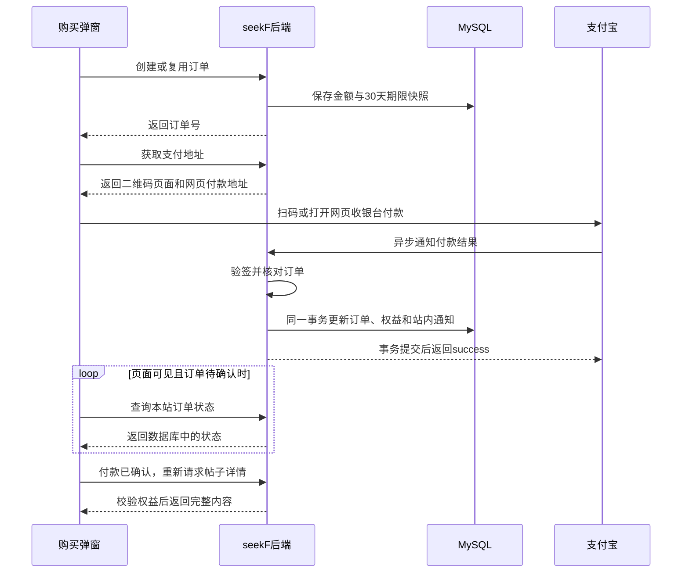
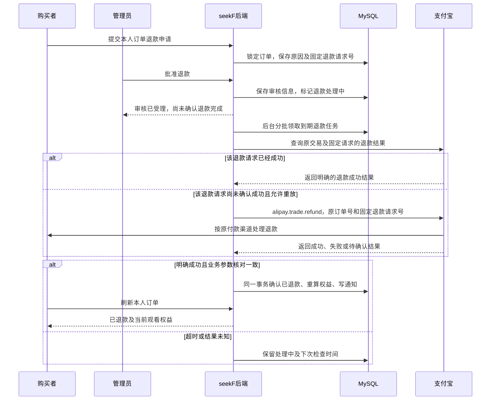

# 支付宝支付实现说明

本文按当前项目代码说明创作者助力的支付与退款。阅读顺序是：**创建本站订单 → 展示支付宝收银台 → 确认付款 → 发放观看权益 → 申请退款 → 管理员审核 → 支付宝原路退款 → 重算权益**。

当前支持支付宝网页支付和弹窗内扫码支付。每笔付款购买指定创作者的30天权益，不自动续费；平台统一收款，创作者收益由本站统计。付款后7天内可申请退款，管理员批准后由后台调用支付宝全额原路退款；尚未实现站内钱包、提现和自动分账。

## 1. 先看完整流程

假设用户小李给“咖啡角落”购买10元助力：

1. 小李打开助力专属帖子，前端展示购买弹窗。
2. 弹窗自动向后端申请订单，后端保存“谁购买、支持谁、10元、30天”等信息。
3. 后端生成这笔订单的扫码地址和网页付款地址，弹窗直接显示二维码。
4. 小李扫码，或点击“网页支付”到支付宝完成付款。
5. 支付宝通知本站；本站验签、核对金额，在数据库事务中确认订单并发放权益。
6. 前端查询到本站订单已付款，重新读取帖子详情，展示完整内容。
7. 如果通知没收到，后台定时向支付宝查单，确认后补发权益。



**弹窗省去了手动创建订单的操作，但后端没有省掉订单。** 订单是核对金额、防止重复发放、查询支付结果和处理异常的依据。

## 2. 代码分别负责什么

| 代码 | 主要职责 |
| --- | --- |
| [SupportPurchase.vue](../../seekF-user/app/components/SupportPurchase.vue) | 打开弹窗后自动下单，展示二维码和网页支付入口 |
| [useSupportPayment.js](../../seekF-user/app/composables/useSupportPayment.js) | 查询本站支付状态、处理账号切换、触发付款成功回调 |
| [support_controller.go](../internal/controllers/user/support_controller.go) | 接收HTTP请求、获取登录用户、返回结果 |
| [support_service.go](../internal/services/user_service/support_service.go) | 下单、付款确认、退款申请与审核事务、权益重算和后台补偿 |
| [管理端support_controller.go](../internal/controllers/admin/support_controller.go) | 接收订单查询与退款审核请求，取得当前管理员身份 |
| [管理端support_service.go](../internal/services/admin_service/support_service.go) | 查询管理订单，调用统一退款审核业务 |
| [support_dao.go](../internal/dao/user_dao/support_dao.go) | 数据库查询、行锁和写入 |
| [alipay.go](../internal/pkg/payment/alipay.go) | 选择网关、检查配置、解析密钥和校验回调地址 |
| [alipay_client.go](../internal/pkg/payment/alipay_client.go) | 签名与验签、生成支付地址、查单、关单、发起及查询退款 |
| [alipay_bill.go](../internal/pkg/payment/alipay_bill.go) | 下载并解析渠道交易账单，核对支付宝侧发生的退款 |
| [support-records.vue](../../seekF-user/app/pages/discover/support-records.vue) | 展示本人订单、提交退款申请、展示退款状态和流程节点 |
| [constants/support.go](../internal/pkg/constants/support.go) | 价格范围、支付期限、任务间隔和状态常量 |

这里的支付协议使用Go标准库实现RSA签名和HTTP请求；支付业务没有另外走Kafka。

## 3. 三张表如何配合

| 表 | 保存什么 | 例子 |
| --- | --- | --- |
| `support_activate` | 创作者是否开通助力、当前价格 | 咖啡角落每30天10.00元 |
| `support_order` | 购买金额、期限、支付状态、渠道交易和退款审核信息 | 小李给咖啡角落下了一笔10元订单，并申请退款 |
| `support_entitlement` | 当前用户对某个创作者的权益截止时间 | 小李可以观看咖啡角落的助力作品直到某日 |

模型见 [support_activate.go](../internal/models/support_activate.go)、[support_order.go](../internal/models/support_order.go)、[support_entitlement.go](../internal/models/support_entitlement.go)。

金额统一以**元**为单位：`support_activate.price`和`support_order.amount`使用`DECIMAL(10,2)`，`support_order.channel_refund_amount`使用`DECIMAL(18,2)`。例如10元保存为`10.00`；后端使用`shopspring/decimal`精确运算，请求支付宝时由`FormatAlipayAmount`输出`"10.00"`。订单和收益接口也返回两位小数字符串，不通过float64计算金额。创作者价格仍限定5～100整数元。

特别注意两个同名字段的区别：

- `support_order.expires_at`：**这笔订单最晚什么时候可以付款**，默认下单后15分钟。
- `support_entitlement.expires_at`：**用户最晚什么时候可以观看助力内容**，付款确认后计算。

订单和权益都带`environment`，查询时区分`sandbox`与`production`。权益由“环境＋购买者＋创作者”唯一确定，购买A的权益不能解锁B的作品。

## 4. 打开弹窗后，怎样自动创建订单

入口是`SupportPurchase.vue`中的`initialize()`，它依次调用：

```text
/user/support/creator/info   查询创作者与当前用户权益
/user/support/order/create   创建或复用本站订单
/user/support/order/pay      获取这笔订单的两种支付地址
```

如果已经有有效权益，弹窗会通知详情重新检查权限，不继续创建订单。

后端`CreateOrder()`的主要步骤是：

1. 检查支付宝配置、请求标识，拒绝给自己购买。
2. 在事务中锁定购买者账号，让同一购买者的并发下单按顺序处理。
3. 根据`request_key`查找已处理的请求，找到就返回原订单。
4. 检查创作者账号正常、已开通助力。
5. 查找同一购买者、同一创作者尚未过期的待支付订单，找到就复用。
6. 没有可复用订单时，从数据库读取价格，创建新的`SO...`订单号。

新订单保存以下快照：

```text
amount          = 创作者当前价格，DECIMAL元金额，例如10.00
duration_hours  = 720小时，即30天
expires_at      = 下单时间 + 15分钟
status          = 0，待付款
next_attempt_at = 下单时间 + 1分钟
```

**价格由后端读数据库决定，前端不提交付款金额。** 例如先下单10元、创作者随后改价20元，原订单继续支付仍是10元。

这里有两层防重：`request_key`处理同一次请求重试；有效待支付订单复用处理用户反复打开弹窗、使用不同请求标识下单。数据库唯一索引进一步约束重复请求键。

## 5. 网页付款与扫码付款有什么区别

后端`PayOrder()`先通过`ownOrder()`确认订单属于当前登录用户和当前支付环境，再检查订单仍待支付且未过期，随后返回：

```json
{
  "pay_url": "支付宝网页收银台地址",
  "qr_url": "支付宝内嵌二维码页面地址"
}
```

两者都由`alipayPageURL()`生成，都使用`alipay.trade.page.pay`，产品码为`FAST_INSTANT_TRADE_PAY`，共用同一个订单号、金额和绝对付款截止时间。

| 方式 | 参数与展示方式 |
| --- | --- |
| 网页支付 | `AlipayPageURL()`设置`return_url`，前端在新标签页打开支付宝收银台 |
| 扫码支付 | `AlipayQRURL()`设置`qr_pay_mode=4`、`qrcode_width=168`，前端用iframe展示支付宝生成的二维码页面 |

**`qr_url`是网页地址，不是二维码图片地址。** 项目没有自行生成支付二维码，也没有另调`alipay.trade.precreate`接口。

扫码请求不设置`return_url`，以便用户在原弹窗等待解锁。两种请求都携带`notify_url`，付款确认方式相同。

生成地址时，后端只组装并签名参数，不主动请求收银台。浏览器打开地址或加载iframe时，才会访问支付宝。

## 6. 签名和验签解决什么问题

签名可以理解为一份可以核验的“签章”，用来确认请求或结果没有被篡改。

### 本站向支付宝发送请求

`alipayParameters()`准备`app_id`、接口名、时间、业务参数等信息；`alipaySign()`随后：

1. 将非空参数按名称排序，排除`sign`本身。
2. 拼成`参数名=参数值&参数名=参数值`的原文。
3. 计算SHA-256摘要，用**应用私钥**执行RSA签名。
4. 将签名Base64编码为`sign`，再对请求参数做URL编码。

代码使用RSA2，即RSA配合SHA-256。应用私钥只在后端读取，不会发送给浏览器或支付宝；支付地址包含的是签名结果。

### 本站接收支付宝结果

`alipayVerify()`使用**支付宝公钥**验证签名。这里要区分：应用私钥用于本站签名，支付宝公钥用于验证支付宝的结果；支付宝公钥不能误填成自己的应用公钥。

两种结果的验签方式略有区别：

- **异步通知**：按通知表单参数重建签名原文，排除`sign`和`sign_type`。
- **查单、关单、退款及账单下载地址响应**：取出响应中的业务JSON原文及`sign`直接验签，不重新序列化JSON。

验签只说明结果可信，后端还会继续核对金额、收款方和订单，不能只凭“签名正确”就发放权益。

## 7. 支付宝怎样通知本站付款成功

入口是：

```text
POST /payment/alipay/notify
```

该路由不要求用户登录，因为请求来自支付宝服务器。它通过验签确认来源，不依赖用户浏览器的登录状态。

`SupportController.AlipayNotify()`限制请求体最大64KiB，只把表单正文交给Service。`VerifyAlipayNotify()`拒绝重复参数，要求RSA2签名，并核对`app_id`和`seller_id`。

之后交给`applySupportTrade()`处理业务。成功时控制器返回纯文本`success`；处理失败则返回`failure`，不会在事务失败时向支付宝确认成功。

### 为什么支付回跳不能用来开通权益

`return_url`让**用户浏览器**回到`/support/result?order_no=...`；`notify_url`让**支付宝服务器**通知后端付款结果。

用户可以关闭网页，也可以修改地址栏参数。因此回跳页只拿订单号向本站查询，不能根据URL中的“成功”参数开通权益。即使用户没回跳，只要后端确认付款，权益仍会生效。

## 8. 如何保证付款与权益一起成功

`applySupportTrade()`是异步通知和后台查单共用的确认入口。

它先解析金额、检查订单号和支付宝交易号，然后开启事务：

1. 用`FindOrder(..., true)`锁定当前订单。
2. 核对金额、收款方，以及已保存的支付宝交易号是否一致。
3. 判断支付宝交易状态；已处理过的付款直接返回，不重复发放。
4. 支付成功时，用`LockEntitlement()`创建或锁定对应权益行。
5. 更新权益截止时间。
6. 将订单更新为已付款，记录交易号、付款时间和本站确认时间。
7. 在同一事务写入一条类型为7的购买者站内通知。

**订单、权益、站内通知任意一步失败，整笔事务回滚。** 不会出现数据库只记了“已付款”，却因后续写入失败而没有权益的半完成状态。

权益计算规则是：

```text
新截止时间 = 较晚者（当前时间，原权益截止时间）+ 本单购买时长
```

例如原权益还剩10天，再付一笔30天，最终剩40天；原权益已过期，则从本站本次确认时间开始算30天。`paid_at`记录支付宝付款时间，`confirmed_at`记录本站确认时间，两者用途不同。

并发时先锁订单、再锁权益。不同订单同时给同一创作者续期，也会在同一权益行上依次计算，避免一笔续期覆盖另一笔。`supportTransaction()`对死锁、锁等待和唯一键冲突最多尝试3次。

### 两套状态不要混淆

| 支付宝状态 | 本站处理 |
| --- | --- |
| `WAIT_BUYER_PAY` | 保持待付款 |
| `TRADE_SUCCESS`、`TRADE_FINISHED` | 确认付款并发放权益 |
| `TRADE_CLOSED` | 未付款订单更新为关闭；不覆盖已付款订单 |

本站`support_order.status`用`0`表示待付款、`1`表示已付款、`2`表示已关闭。`refund_status`是另一组字段，不能把交易关闭通知直接当作已完成退款。

可信的成功结果即使晚于本站关单记录到达，也会经过同样的校验和事务确认，避免遗漏实际付款。

## 9. 为什么需要后台查单与关单补偿

主入口中的这段代码启动支付与退款兜底任务：

```go
// 启动助力订单查单、关单与退款补偿，并分批核对每日渠道退款账单。
userservice.StartSupportOrderScanner(context.Background())
```

`StartSupportOrderScanner()`内部启动goroutine，不阻塞主服务。启动后先扫描一次，再按一分钟ticker继续扫描；传入`context.Background()`时没有主动取消信号，任务随服务进程持续运行。

这里的“到期任务”指**到了`next_attempt_at`、该执行检查的订单**，不只指超过15分钟付款期限的订单。

### 每轮做什么

1. `scanSupportOrders()`在短事务中调用`ClaimOrders()`，领取当前环境最多20笔待付款任务。
2. 领取事务提交后，并发执行支付宝查询；不在持有数据库行锁时等待网络。
3. 每笔补偿总超时45秒，单次支付宝HTTP请求超时12秒。
4. 处理结束后通过`FinishAttempt()`保存错误或下次检查时间。

`reconcileSupportOrder()`的判断顺序如下：

| 查单结果 | 处理方式 |
| --- | --- |
| 已付款 | 调用`applySupportTrade()`，补确认订单和权益 |
| 仍未付款，本站支付期限未过 | 暂不关单，后续再查 |
| 仍未付款或交易不存在，本站支付期限已过 | 请求`alipay.trade.close`关单 |
| 查单、关单超时，或结果不明确 | 保留待确认状态并重试 |
| 关单返回可能与付款冲突的结果 | 再查一次；确认已付款则发放权益 |

只有关单成功、渠道确认不存在或已关闭等明确结果，才会在锁定订单并复核状态后写入关闭。**本地计时到15分钟，不等于可以直接把数据库订单改成关闭。**

### 多台后端如何避免重复领取

`ClaimOrders()`使用`FOR UPDATE SKIP LOCKED`跳过其他实例正在锁定的记录，并保存2分钟的`processing_until`租约，可以理解为“这笔任务暂时由我处理”。

任务领取状态保存在订单表，而不只在内存中。进程意外退出后，其他实例可以在租约过期后重新领取。

完成任务时，`FinishAttempt()`要求订单仍待付款，且租约仍等于本次领取的值，才释放租约并安排下次检查，避免旧任务覆盖新的领取结果或并发付款通知。最终权益确认仍靠事务和幂等保证，不依赖“任务绝不重复执行”。

补偿按批次和租约执行；有积压或失败时，不能保证每笔订单都在一分钟内完成确认。

同一扫描器每轮还会调用`scanSupportRefunds()`领取退款及渠道核对任务；退款的查询和重试过程见第13～16节。

## 10. 前端怎么知道已经付款

`useSupportPayment.js`每3秒调用一次：

```text
POST /user/support/order/info
{ "order_no": "SO..." }
```

后端`GetOrder()`只查询本站数据库，**不会因为浏览器每3秒刷新，就每3秒向支付宝查单**。

前端只在页面可见、订单待付款、自动查询未超过15分钟时继续轮询。页面隐藏时暂停，关闭组件或切换账号时取消请求并丢弃旧响应，查询结束后仍可手动刷新。

本站返回`status=1`后：

- 购买弹窗触发`paid`事件，帖子详情重新请求服务端权限。
- 网页支付结果页通过`localStorage`信号通知其他标签页；原帖子重新获得焦点时也会检查权限。
- 较早返回的待支付响应不能覆盖前端已经看到的付款成功状态。

原锁定帖子经服务端重新查询确认已解锁后，会弹出“支付成功，助力权益已生效”；网页支付回跳页确认订单已付款时也会提示。同一页面中的重复查询不会反复提示，首次打开已有权限的帖子不会误报为本次付款成功。

存储信号只是提醒页面重新查询，不能授予观看权限。真正的判断仍在后端：帖子可见、购买者与创作者匹配、当前环境一致、权益未过期。正文、评论和受保护文件读取都会按业务入口检查权限。

## 11. 配置与本地联调

配置结构在[configs.go](../internal/configs/configs.go)，从`config/config.toml`加载基础配置，再由环境变量覆盖；`.env`通过godotenv加载。本文不包含实际密钥。

| 配置 | 用途 |
| --- | --- |
| `ALIPAY_ENVIRONMENT` | `sandbox`沙箱或`production`正式环境，决定固定网关 |
| `ALIPAY_APP_ID` | 当前应用ID |
| `ALIPAY_SELLER_ID` | 当前应用对应的收款商家ID，非帖子创作者的用户ID |
| `ALIPAY_PRIVATE_KEY` | 应用RSA私钥，用于请求签名 |
| `ALIPAY_PUBLIC_KEY` | 支付宝公钥，用于通知和响应验签 |
| `ALIPAY_RETURN_URL` | 浏览器支付完成后的前端回跳地址 |
| `ALIPAY_NOTIFY_URL` | 支付宝服务器通知后端的地址 |

当前代码要求RSA密钥至少2048位，应用私钥兼容PKCS#8和PKCS#1，密钥可使用单行Base64或PEM。通知地址必须使用公网HTTPS；沙箱回跳页允许HTTP，正式回跳要求HTTPS。

本地联调的地址关系是：

```text
前端回跳：http://localhost:3000/support/result
后台通知：https://你的ngrok域名/payment/alipay/notify
ngrok转发：http://localhost:8080
```

`localhost`对于支付宝服务器不是你的电脑，所以异步通知需要公网入口。ngrok地址改变后，需要同步更新配置、重启后端；新生成的支付请求才会带上新通知地址。

配置校验发生在下单、生成支付参数等实际支付操作中，支付配置缺失不会单独阻止整个后端启动。沙箱与正式环境必须使用各自的应用和密钥，部署时仍应隔离测试与正式数据。

## 12. 接口与排查入口

以下本站接口均为POST。用户端接口要求用户登录，管理端接口要求管理员身份；支付宝通知通过独立验签入口访问。后端不信任前端指定的购买者或审核人。

| 接口 | 作用 |
| --- | --- |
| `/user/support/creator/info` | 查询创作者价格和本人权益 |
| `/user/support/creator/save` | 本人开通助力或修改价格 |
| `/user/support/order/create` | 创建或复用待支付订单 |
| `/user/support/order/pay` | 获取同单的扫码与网页付款地址 |
| `/user/support/order/info` | 查询本人订单的本站确认状态 |
| `/user/support/order/list` | 分页查询本人已确认付款的购买订单，总数采用相同筛选条件；未付款和已关闭订单不在记录页展示 |
| `/user/support/entitlement/list` | 查询本人按创作者汇总的权益 |
| `/user/support/creator/records` | 查询本人作为创作者收到的已付款助力 |
| `/user/support/creator/income` | 汇总本人创作者实收、退款金额和净额 |
| `/user/support/refund/apply` | 当前购买者在付款后7天内提交一次退款申请 |
| `/admin/support/orders` | 管理员查询订单及退款审核状态 |
| `/admin/support/refund/review` | 管理员批准、驳回或按原请求重试明确失败的退款 |
| `/payment/alipay/notify` | 接收并验签支付宝异步通知 |

收益直接根据已付款订单汇总，不是支付宝余额查询，也不代表本站提供可提现余额。退款申请、审核及渠道退款已实现，具体流程如下；真实资金结果仍以支付宝及银行处理为准。

| 现象 | 优先检查 |
| --- | --- |
| 弹窗报配置不完整 | 后端是否加载正确`.env`，应用与两类密钥是否填全 |
| 二维码无法付款 | 本单是否过期、支付宝页面报错，以及当前应用配置 |
| 支付宝已扣款，页面仍待确认 | ngrok和后端是否在线，通知日志及后台查单日志 |
| 数据库仍待付款且`last_error`不为空 | 查单是否超时、响应是否验签失败，后台是否仍在重试 |
| 已付款但作品未解锁 | 是否同一登录账号、同一创作者及环境；权益是否有效；帖子本身是否可见 |
| 重复收到同一订单通知 | 正常走幂等确认；检查权益和站内通知是否只增加一次 |

阅读源码时，可以先看`CreateOrder → PayOrder → Notify → applySupportTrade`这条主线，再看`StartSupportOrderScanner → scanSupportOrders → reconcileSupportOrder`这条补偿线。两条线最终使用同一套付款确认与权益事务。

## 13. 退款审核通过后，钱怎么退给用户

**seekF没有给站内余额执行“加10元”的代码。资金退回由支付宝完成，本站负责发起退款、核对结果和更新订单及观看权益。**

继续用小李的10元订单举例：小李在“助力记录 → 我的订单”申请退款，管理员批准后，数据库先记为“退款处理中”。后台任务再向支付宝发起该订单的全额退款；支付宝根据原订单找到买家和原付款渠道，按退款规则退回款项。

如果原来使用支付宝余额付款，退款通常回到对应余额；原来使用银行卡付款，退款可能回到原银行卡，因此不能只看支付宝余额是否增加来判断是否收到退款。本站显示“已退款”表示已取得渠道的明确成功结果，银行卡实际入账可能仍需后续处理。依据：[支付宝原路退款说明](https://aipay.alipay.com/docs/vibe-pay/ai-web-app-payment-qianyi/api-list/alipay-trade-refund.html)、[支付宝退款到账说明](https://global.alipay.com/developer/helpcenter/detail?_route=sg&categoryId=50480&knowId=201602452414&sceneCode=AC_DEV)。



这里的三件事发生在不同阶段：**管理员批准、支付宝确认退款成功、用户原付款账户实际入账**。代码不会仅凭审核通过就显示已退款。

## 14. 申请和审核分别修改什么

用户请求：

```text
POST /user/support/refund/apply
{ "order_no": "SO...", "reason": "申请原因" }
```

`RequestRefund()`在事务中锁定订单，检查订单属于当前用户、已付款、尚未申请退款，并且仍在`paid_at`之后连续168小时内。截止瞬间不再接受申请；时间窗口依据渠道付款时间，不是本站创建订单的时间。

通过后保存：

```text
refund_status       = 1，待审核
refund_requested_at = 本次申请时间
refund_reason       = 用户填写的原因
refund_request_no   = 固定的SR...请求号
```

`refund_requested_at`非空后不允许再次申请，驳回后也不能重新提交。同一订单的重复点击或并发请求在订单锁内处理，不能生成多份退款申请。

管理员请求：

```text
POST /admin/support/refund/review
{ "order_no": "SO...", "action": "approve", "note": "同意退款" }
```

调用顺序为`AdminController.ReviewSupportRefund → AdminService.ReviewSupportRefund → userservice.ReviewSupportRefund`。操作者来自管理员登录身份，不取前端传入的审核人ID。统一业务函数再次校验管理员账号并锁定订单：

| 操作 | 允许的当前状态 | 保存结果 |
| --- | --- | --- |
| `approve` | 待审核 | `refund_status=3`，处理中 |
| `reject` | 待审核 | `refund_status=2`，已驳回 |
| `retry` | 明确退款失败 | 重新进入处理中，仍用原退款请求号；资金差异需人工核对时不直接重试 |

每次操作保存`refund_reviewer_id`、`refund_reviewed_at`及`refund_review_note`。批准或重试时将`next_attempt_at`设为当前时间，交给后台处理；HTTP审核请求本身不等待支付宝退款。

## 15. 后台实际向支付宝发送什么

`StartSupportOrderScanner → scanSupportRefunds → reconcileSupportRefund`构成退款处理链。`ClaimRefundOrders()`用`FOR UPDATE SKIP LOCKED`分批领取最多20笔，持久化2分钟租约；领取事务提交后才发起网络请求。

对于处理中订单，`reconcileSupportRefund()`先调用`alipay.trade.query`核对原订单号、支付宝交易号、原付款金额及商户，再调用`alipay.trade.fastpay.refund.query`查询固定退款请求。已经成功的请求直接进入本站确认逻辑；只有查询没有确认成功且允许重放时，才调用`alipay.trade.refund`。

`AlipayRefundRequest()`为10元订单组装的退款业务参数类似：

```json
{
  "out_trade_no": "SO原订单号",
  "out_request_no": "SR固定退款请求号",
  "refund_amount": "10.00"
}
```

- `out_trade_no`关联原交易，支付宝据此确定退款对象，本站无需再传买家的支付宝账号。
- `out_request_no`标识本次退款，申请时生成后一直保持不变。
- `refund_amount`来自本站订单金额快照，直接使用精确十进制元，不采用前端金额。

参数经过应用私钥RSA2签名后发送到当前环境的支付宝网关，响应经过支付宝公钥验签后才交给业务处理。退款查询使用相同订单号与请求号，并请求返回退款时间。

网络超时并不说明没有退款，可能是支付宝已处理但响应未到达本站。因此未知结果继续保持`refund_status=3`，后续按同一请求号查询或安全重放，不能另生成请求号重新退款。进程重启后可以在租约到期后继续处理。

明确的余额不足等失败会记录`refund_status=5`和失败原因，管理员处理后可按原请求重试；渠道金额不一致、部分退款等资金差异转入人工核对。支付宝调用放在数据库事务外，避免等待网络时长时间持有订单和权益行锁。

## 16. 退款成功怎样同步权益、通知和收益

`applySupportRefundResult()`核对退款响应的订单号、交易号及全额金额；退款查询结果还要核对固定请求号，查询只有明确`REFUND_SUCCESS`才当作成功。随后调用`confirmSupportRefund()`，在一个事务里完成：

1. 锁定订单；已确认全额退款则直接返回，不重复处理。
2. 创建或锁定该购买者、该创作者、当前环境对应的权益行。
3. 保存`refund_status=4`和`refunded_at`，清除处理租约及错误。
4. 从该购买者与创作者的已付款订单重算权益截止时间。
5. 保存类型8的退款成功站内通知。

其中任何数据库操作失败都会回滚；下一轮查询仍可取得已成功的渠道退款结果，再补齐本站数据。支付宝已发生的资金退款不会因本站事务回滚而撤销。

### 多次续期后，退一笔怎么算

`supportRefundExpiry()`按`confirmed_at, id`升序遍历已付款订单，跳过确认全额退款的订单，每笔按下面的规则累加：

```text
本笔开始时间 = 较晚者（本笔confirmed_at，前一笔权益结束时间）
本笔结束时间 = 本笔开始时间 + duration_hours
```

例如同一时刻连续购买三笔30天，原本共90天，退掉其中一笔后按剩余两笔重新得到60天；不能把整个创作者的观看权益直接清空。没有有效订单时截止时间置空。实际订单存在不同确认时间时按上述顺序重算，不是简单从当前时间减30天。

支付确认与退款确认共用“订单→权益”锁顺序；`supportTransaction()`使用READ COMMITTED，持有权益锁后读取最新已提交订单，避免并发续期被旧事务快照覆盖。**退款确认前原有权益保持不变。**

### 为什么不直接修改创作者余额

项目没有创作者钱包余额和独立收益流水。`SupportDAO.Income()`仍从已付款订单计算：

```text
实收 = 已付款订单金额总和
退款 = refund_status=4的已付款订单金额总和
净额 = 实收 - 退款
```

10元订单全额退款后仍保留`status=1`，只改变退款状态，因此统计结果为实收10.00元、退款10.00元、净额0.00元。处理中或失败的退款尚不计入已退款金额。接口返回`gross_amount/refund_amount/net_amount`，均为两位小数元字符串。

## 17. 支付宝侧退款、页面状态和排查

管理员也可能直接在支付宝侧操作退款。普通`alipay.trade.query`不提供累计退款金额，本站通过`alipay.data.dataservice.bill.downloadurl.query`下载每日交易账单，按商户订单号与支付宝交易号核对退款明细。

`auditSupportRefundBill()`将已核对自然日保存到`refund_checked_date`，累计金额保存到`channel_refund_amount`，重启后接着查，重复核对同一天不重复累计。金额等于原付款金额时走同一套全额退款确认事务；发现部分退款或异常资金差异则交人工核对，不按金额折算观看天数。本期业务仍只提供全额退款。

账单按北京时间逐日核对，渠道采用T+1出账，因此站外退款同步有出账延迟。账单下载失败、未生成或解析失败时保留进度重试；只有已验签的明确空账单才当作零退款，不能将“没有取到账单”视为“没有退款”。

用户端“我的订单”右侧优先显示退款状态，下方展示申请、审核和退款处理节点。状态来自本站订单查询，记录页通过提交申请后的重新加载及“刷新记录”按钮获取最新结果，不会仅凭用户操作自行认定退款成功。

| 现象 | 优先检查 |
| --- | --- |
| 审核后仍显示退款处理中 | 后端扫描任务是否运行、`next_attempt_at`和租约是否到期、`last_error`是否记录渠道超时或未知结果 |
| 显示明确退款失败 | 管理端查看原因，例如商户余额不足；处理后按原请求重试 |
| 显示需人工核对 | 查看支付宝侧是否已有部分退款、交易号或金额是否不一致，不直接重新发起一笔退款 |
| 本站已退款但支付宝余额没增加 | 核对原付款渠道；原路退回银行卡时应查看该卡，而不是只看支付宝余额 |
| 支付宝确认退款成功但本站仍处理中 | 检查响应验签、金额核对及本站退款事务是否失败，后台会继续查询并补确认 |
| 直接在支付宝退款后本站未更新 | 检查账单出账、下载权限、已核对日期及后台账单核对错误 |

支付和退款相关模拟检查不等同于真实沙箱验收。真实渠道能力及账户实际到账仍需联调确认；后端由用户自行启动或重启。
