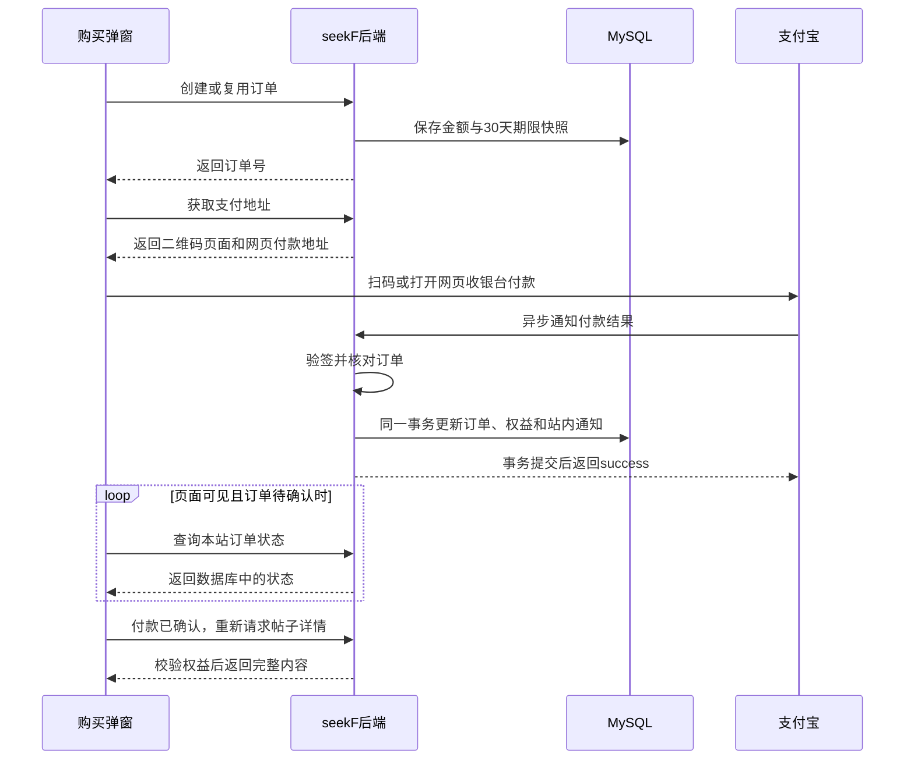

# 支付宝支付实现说明

本文按当前项目代码说明一次创作者助力付款如何完成。阅读顺序是：**创建本站订单 → 展示支付宝收银台 → 确认付款 → 发放观看权益**。

当前支持支付宝网页支付和弹窗内扫码支付。每笔付款购买指定创作者的30天权益，不自动续费；平台统一收款，创作者收益由本站统计，尚未实现提现、自动分账和退款业务流程。

## 1. 先看完整流程

假设用户小李给“咖啡角落”购买10元助力：

1. 小李打开助力专属帖子，前端展示购买弹窗。
2. 弹窗自动向后端申请订单，后端保存“谁购买、支持谁、10元、30天”等信息。
3. 后端生成这笔订单的扫码地址和网页付款地址，弹窗直接显示二维码。
4. 小李扫码，或点击“网页支付”到支付宝完成付款。
5. 支付宝通知本站；本站验签、核对金额，在数据库事务中确认订单并发放权益。
6. 前端查询到本站订单已付款，重新读取帖子详情，展示完整内容。
7. 如果通知没收到，后台定时向支付宝查单，确认后补发权益。



**弹窗省去了手动创建订单的操作，但后端没有省掉订单。** 订单是核对金额、防止重复发放、查询支付结果和处理异常的依据。

## 2. 代码分别负责什么

| 代码 | 主要职责 |
| --- | --- |
| [SupportPurchase.vue](../../seekF-user/app/components/SupportPurchase.vue) | 打开弹窗后自动下单，展示二维码和网页支付入口 |
| [useSupportPayment.js](../../seekF-user/app/composables/useSupportPayment.js) | 查询本站支付状态、处理账号切换、触发付款成功回调 |
| [support_controller.go](../internal/controllers/user/support_controller.go) | 接收HTTP请求、获取登录用户、返回结果 |
| [support_service.go](../internal/services/user_service/support_service.go) | 下单校验、事务、付款确认、权益发放和后台补偿 |
| [support_dao.go](../internal/dao/user_dao/support_dao.go) | 数据库查询、行锁和写入 |
| [alipay.go](../internal/pkg/payment/alipay.go) | 选择网关、检查配置、解析密钥和校验回调地址 |
| [alipay_client.go](../internal/pkg/payment/alipay_client.go) | 组装支付宝参数、签名、验签、生成支付地址、查单和关单 |
| [constants/support.go](../internal/pkg/constants/support.go) | 价格范围、支付期限、任务间隔和状态常量 |

这里的支付协议使用Go标准库实现RSA签名和HTTP请求；支付业务没有另外走Kafka。

## 3. 三张表如何配合

| 表 | 保存什么 | 例子 |
| --- | --- | --- |
| `support_activate` | 创作者是否开通助力、当前价格 | 咖啡角落每30天1000分 |
| `support_order` | 每次购买的金额、期限、支付状态和渠道交易信息 | 小李给咖啡角落下了一笔10元订单 |
| `support_entitlement` | 当前用户对某个创作者的权益截止时间 | 小李可以观看咖啡角落的助力作品直到某日 |

模型见 [support_activate.go](../internal/models/support_activate.go)、[support_order.go](../internal/models/support_order.go)、[support_entitlement.go](../internal/models/support_entitlement.go)。

金额使用**整数分**存储，例如10元保存为`1000`，请求支付宝时由`FormatAlipayAmount`转成`"10.00"`，避免浮点计算误差。

特别注意两个同名字段的区别：

- `support_order.expires_at`：**这笔订单最晚什么时候可以付款**，默认下单后15分钟。
- `support_entitlement.expires_at`：**用户最晚什么时候可以观看助力内容**，付款确认后计算。

订单和权益都带`environment`，查询时区分`sandbox`与`production`。权益由“环境＋购买者＋创作者”唯一确定，购买A的权益不能解锁B的作品。

## 4. 打开弹窗后，怎样自动创建订单

入口是`SupportPurchase.vue`中的`initialize()`，它依次调用：

```text
/user/support/creator/info   查询创作者与当前用户权益
/user/support/order/create   创建或复用本站订单
/user/support/order/pay      获取这笔订单的两种支付地址
```

如果已经有有效权益，弹窗会通知详情重新检查权限，不继续创建订单。

后端`CreateOrder()`的主要步骤是：

1. 检查支付宝配置、请求标识，拒绝给自己购买。
2. 在事务中锁定购买者账号，让同一购买者的并发下单按顺序处理。
3. 根据`request_key`查找已处理的请求，找到就返回原订单。
4. 检查创作者账号正常、已开通助力。
5. 查找同一购买者、同一创作者尚未过期的待支付订单，找到就复用。
6. 没有可复用订单时，从数据库读取价格，创建新的`SO...`订单号。

新订单保存以下快照：

```text
amount_fen      = 创作者当前价格，单位分
duration_hours  = 720小时，即30天
expires_at      = 下单时间 + 15分钟
status          = 0，待付款
next_attempt_at = 下单时间 + 1分钟
```

**价格由后端读数据库决定，前端不提交付款金额。** 例如先下单10元、创作者随后改价20元，原订单继续支付仍是10元。

这里有两层防重：`request_key`处理同一次请求重试；有效待支付订单复用处理用户反复打开弹窗、使用不同请求标识下单。数据库唯一索引进一步约束重复请求键。

## 5. 网页付款与扫码付款有什么区别

后端`PayOrder()`先通过`ownOrder()`确认订单属于当前登录用户和当前支付环境，再检查订单仍待支付且未过期，随后返回：

```json
{
  "pay_url": "支付宝网页收银台地址",
  "qr_url": "支付宝内嵌二维码页面地址"
}
```

两者都由`alipayPageURL()`生成，都使用`alipay.trade.page.pay`，产品码为`FAST_INSTANT_TRADE_PAY`，共用同一个订单号、金额和绝对付款截止时间。

| 方式 | 参数与展示方式 |
| --- | --- |
| 网页支付 | `AlipayPageURL()`设置`return_url`，前端在新标签页打开支付宝收银台 |
| 扫码支付 | `AlipayQRURL()`设置`qr_pay_mode=4`、`qrcode_width=168`，前端用iframe展示支付宝生成的二维码页面 |

**`qr_url`是网页地址，不是二维码图片地址。** 项目没有自行生成支付二维码，也没有另调`alipay.trade.precreate`接口。

扫码请求不设置`return_url`，以便用户在原弹窗等待解锁。两种请求都携带`notify_url`，付款确认方式相同。

生成地址时，后端只组装并签名参数，不主动请求收银台。浏览器打开地址或加载iframe时，才会访问支付宝。

## 6. 签名和验签解决什么问题

签名可以理解为一份可以核验的“签章”，用来确认请求或结果没有被篡改。

### 本站向支付宝发送请求

`alipayParameters()`准备`app_id`、接口名、时间、业务参数等信息；`alipaySign()`随后：

1. 将非空参数按名称排序，排除`sign`本身。
2. 拼成`参数名=参数值&参数名=参数值`的原文。
3. 计算SHA-256摘要，用**应用私钥**执行RSA签名。
4. 将签名Base64编码为`sign`，再对请求参数做URL编码。

代码使用RSA2，即RSA配合SHA-256。应用私钥只在后端读取，不会发送给浏览器或支付宝；支付地址包含的是签名结果。

### 本站接收支付宝结果

`alipayVerify()`使用**支付宝公钥**验证签名。这里要区分：应用私钥用于本站签名，支付宝公钥用于验证支付宝的结果；支付宝公钥不能误填成自己的应用公钥。

两种结果的验签方式略有区别：

- **异步通知**：按通知表单参数重建签名原文，排除`sign`和`sign_type`。
- **查单、关单响应**：取出响应中的业务JSON原文及`sign`直接验签，不重新序列化JSON。

验签只说明结果可信，后端还会继续核对金额、收款方和订单，不能只凭“签名正确”就发放权益。

## 7. 支付宝怎样通知本站付款成功

入口是：

```text
POST /payment/alipay/notify
```

该路由不要求用户登录，因为请求来自支付宝服务器。它通过验签确认来源，不依赖用户浏览器的登录状态。

`SupportController.AlipayNotify()`限制请求体最大64KiB，只把表单正文交给Service。`VerifyAlipayNotify()`拒绝重复参数，要求RSA2签名，并核对`app_id`和`seller_id`。

之后交给`applySupportTrade()`处理业务。成功时控制器返回纯文本`success`；处理失败则返回`failure`，不会在事务失败时向支付宝确认成功。

### 为什么支付回跳不能用来开通权益

`return_url`让**用户浏览器**回到`/support/result?order_no=...`；`notify_url`让**支付宝服务器**通知后端付款结果。

用户可以关闭网页，也可以修改地址栏参数。因此回跳页只拿订单号向本站查询，不能根据URL中的“成功”参数开通权益。即使用户没回跳，只要后端确认付款，权益仍会生效。

## 8. 如何保证付款与权益一起成功

`applySupportTrade()`是异步通知和后台查单共用的确认入口。

它先解析金额、检查订单号和支付宝交易号，然后开启事务：

1. 用`FindOrder(..., true)`锁定当前订单。
2. 核对金额、收款方，以及已保存的支付宝交易号是否一致。
3. 判断支付宝交易状态；已处理过的付款直接返回，不重复发放。
4. 支付成功时，用`LockEntitlement()`创建或锁定对应权益行。
5. 更新权益截止时间。
6. 将订单更新为已付款，记录交易号、付款时间和本站确认时间。
7. 在同一事务写入一条类型为7的购买者站内通知。

**订单、权益、站内通知任意一步失败，整笔事务回滚。** 不会出现数据库只记了“已付款”，却因后续写入失败而没有权益的半完成状态。

权益计算规则是：

```text
新截止时间 = 较晚者（当前时间，原权益截止时间）+ 本单购买时长
```

例如原权益还剩10天，再付一笔30天，最终剩40天；原权益已过期，则从本站本次确认时间开始算30天。`paid_at`记录支付宝付款时间，`confirmed_at`记录本站确认时间，两者用途不同。

并发时先锁订单、再锁权益。不同订单同时给同一创作者续期，也会在同一权益行上依次计算，避免一笔续期覆盖另一笔。`supportTransaction()`对死锁、锁等待和唯一键冲突最多尝试3次。

### 两套状态不要混淆

| 支付宝状态 | 本站处理 |
| --- | --- |
| `WAIT_BUYER_PAY` | 保持待付款 |
| `TRADE_SUCCESS`、`TRADE_FINISHED` | 确认付款并发放权益 |
| `TRADE_CLOSED` | 未付款订单更新为关闭；不覆盖已付款订单 |

本站`support_order.status`用`0`表示待付款、`1`表示已付款、`2`表示已关闭。`refund_status`是另一组字段，不能把交易关闭通知直接当作已完成退款。

可信的成功结果即使晚于本站关单记录到达，也会经过同样的校验和事务确认，避免遗漏实际付款。

## 9. 为什么需要后台查单与关单补偿

主入口中的这段代码启动支付兜底任务：

```go
// 启动助力订单持久化查单与关单补偿，每分钟领取到期任务。
userservice.StartSupportOrderScanner(context.Background())
```

`StartSupportOrderScanner()`内部启动goroutine，不阻塞主服务。启动后先扫描一次，再按一分钟ticker继续扫描；传入`context.Background()`时没有主动取消信号，任务随服务进程持续运行。

这里的“到期任务”指**到了`next_attempt_at`、该执行检查的订单**，不只指超过15分钟付款期限的订单。

### 每轮做什么

1. `scanSupportOrders()`在短事务中调用`ClaimOrders()`，领取当前环境最多20笔待付款任务。
2. 领取事务提交后，并发执行支付宝查询；不在持有数据库行锁时等待网络。
3. 每笔补偿总超时45秒，单次支付宝HTTP请求超时12秒。
4. 处理结束后通过`FinishAttempt()`保存错误或下次检查时间。

`reconcileSupportOrder()`的判断顺序如下：

| 查单结果 | 处理方式 |
| --- | --- |
| 已付款 | 调用`applySupportTrade()`，补确认订单和权益 |
| 仍未付款，本站支付期限未过 | 暂不关单，后续再查 |
| 仍未付款或交易不存在，本站支付期限已过 | 请求`alipay.trade.close`关单 |
| 查单、关单超时，或结果不明确 | 保留待确认状态并重试 |
| 关单返回可能与付款冲突的结果 | 再查一次；确认已付款则发放权益 |

只有关单成功、渠道确认不存在或已关闭等明确结果，才会在锁定订单并复核状态后写入关闭。**本地计时到15分钟，不等于可以直接把数据库订单改成关闭。**

### 多台后端如何避免重复领取

`ClaimOrders()`使用`FOR UPDATE SKIP LOCKED`跳过其他实例正在锁定的记录，并保存2分钟的`processing_until`租约，可以理解为“这笔任务暂时由我处理”。

任务领取状态保存在订单表，而不只在内存中。进程意外退出后，其他实例可以在租约过期后重新领取。

完成任务时，`FinishAttempt()`要求订单仍待付款，且租约仍等于本次领取的值，才释放租约并安排下次检查，避免旧任务覆盖新的领取结果或并发付款通知。最终权益确认仍靠事务和幂等保证，不依赖“任务绝不重复执行”。

补偿按批次和租约执行；有积压或失败时，不能保证每笔订单都在一分钟内完成确认。

## 10. 前端怎么知道已经付款

`useSupportPayment.js`每3秒调用一次：

```text
POST /user/support/order/info
{ "order_no": "SO..." }
```

后端`GetOrder()`只查询本站数据库，**不会因为浏览器每3秒刷新，就每3秒向支付宝查单**。

前端只在页面可见、订单待付款、自动查询未超过15分钟时继续轮询。页面隐藏时暂停，关闭组件或切换账号时取消请求并丢弃旧响应，查询结束后仍可手动刷新。

本站返回`status=1`后：

- 购买弹窗触发`paid`事件，帖子详情重新请求服务端权限。
- 网页支付结果页通过`localStorage`信号通知其他标签页；原帖子重新获得焦点时也会检查权限。
- 较早返回的待支付响应不能覆盖前端已经看到的付款成功状态。

原锁定帖子经服务端重新查询确认已解锁后，会弹出“支付成功，助力权益已生效”；网页支付回跳页确认订单已付款时也会提示。同一页面中的重复查询不会反复提示，首次打开已有权限的帖子不会误报为本次付款成功。

存储信号只是提醒页面重新查询，不能授予观看权限。真正的判断仍在后端：帖子可见、购买者与创作者匹配、当前环境一致、权益未过期。正文、评论和受保护文件读取都会按业务入口检查权限。

## 11. 配置与本地联调

配置结构在[configs.go](../internal/configs/configs.go)，从`config/config.toml`加载基础配置，再由环境变量覆盖；`.env`通过godotenv加载。本文不包含实际密钥。

| 配置 | 用途 |
| --- | --- |
| `ALIPAY_ENVIRONMENT` | `sandbox`沙箱或`production`正式环境，决定固定网关 |
| `ALIPAY_APP_ID` | 当前应用ID |
| `ALIPAY_SELLER_ID` | 当前应用对应的收款商家ID，非帖子创作者的用户ID |
| `ALIPAY_PRIVATE_KEY` | 应用RSA私钥，用于请求签名 |
| `ALIPAY_PUBLIC_KEY` | 支付宝公钥，用于通知和响应验签 |
| `ALIPAY_RETURN_URL` | 浏览器支付完成后的前端回跳地址 |
| `ALIPAY_NOTIFY_URL` | 支付宝服务器通知后端的地址 |

当前代码要求RSA密钥至少2048位，应用私钥兼容PKCS#8和PKCS#1，密钥可使用单行Base64或PEM。通知地址必须使用公网HTTPS；沙箱回跳页允许HTTP，正式回跳要求HTTPS。

本地联调的地址关系是：

```text
前端回跳：http://localhost:3000/support/result
后台通知：https://你的ngrok域名/payment/alipay/notify
ngrok转发：http://localhost:8080
```

`localhost`对于支付宝服务器不是你的电脑，所以异步通知需要公网入口。ngrok地址改变后，需要同步更新配置、重启后端；新生成的支付请求才会带上新通知地址。

配置校验发生在下单、生成支付参数等实际支付操作中，支付配置缺失不会单独阻止整个后端启动。沙箱与正式环境必须使用各自的应用和密钥，部署时仍应隔离测试与正式数据。

## 12. 接口与排查入口

以下本站接口均为POST；除支付宝通知外都要求登录，身份由后端会话获取，不信任前端指定的购买者。

| 接口 | 作用 |
| --- | --- |
| `/user/support/creator/info` | 查询创作者价格和本人权益 |
| `/user/support/creator/save` | 本人开通助力或修改价格 |
| `/user/support/order/create` | 创建或复用待支付订单 |
| `/user/support/order/pay` | 获取同单的扫码与网页付款地址 |
| `/user/support/order/info` | 查询本人订单的本站确认状态 |
| `/user/support/order/list` | 分页查询本人已确认付款的购买订单，总数采用相同筛选条件；未付款和已关闭订单不在记录页展示 |
| `/user/support/entitlement/list` | 查询本人按创作者汇总的权益 |
| `/user/support/creator/records` | 查询本人作为创作者收到的已付款助力 |
| `/user/support/creator/income` | 汇总本人创作者实收、退款金额和净额 |
| `/payment/alipay/notify` | 接收并验签支付宝异步通知 |

收益直接根据已付款订单汇总，不是支付宝余额查询，也不代表本站提供可提现余额。模型虽已包含退款状态及相关字段，当前没有退款申请、审核和渠道退款的完整实现。

| 现象 | 优先检查 |
| --- | --- |
| 弹窗报配置不完整 | 后端是否加载正确`.env`，应用与两类密钥是否填全 |
| 二维码无法付款 | 本单是否过期、支付宝页面报错，以及当前应用配置 |
| 支付宝已扣款，页面仍待确认 | ngrok和后端是否在线，通知日志及后台查单日志 |
| 数据库仍待付款且`last_error`不为空 | 查单是否超时、响应是否验签失败，后台是否仍在重试 |
| 已付款但作品未解锁 | 是否同一登录账号、同一创作者及环境；权益是否有效；帖子本身是否可见 |
| 重复收到同一订单通知 | 正常走幂等确认；检查权益和站内通知是否只增加一次 |

阅读源码时，可以先看`CreateOrder → PayOrder → Notify → applySupportTrade`这条主线，再看`StartSupportOrderScanner → scanSupportOrders → reconcileSupportOrder`这条补偿线。两条线最终使用同一套付款确认与权益事务。
