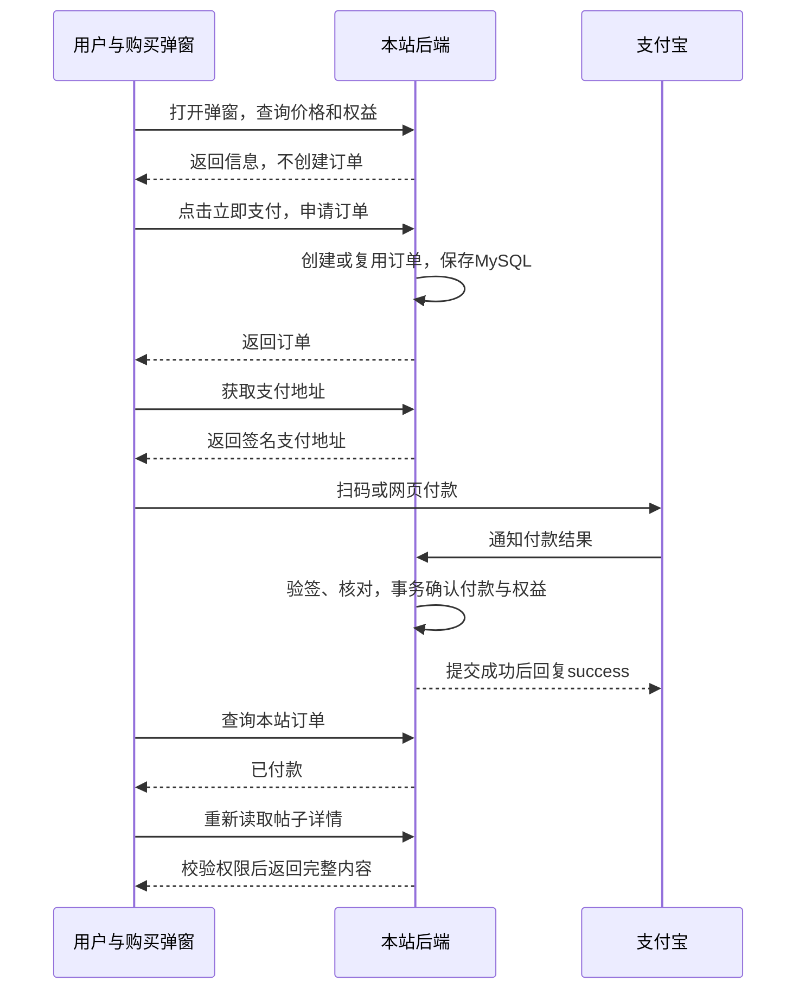

# 支付宝支付流程

用户通过支付宝购买某位创作者的30天助力权益，可以扫码或打开网页付款。支付宝负责收款、退款和提现转账；本站负责订单、观看权限、创作者收益账户和页面状态。

## 1. 从打开弹窗到解锁作品

以小李购买“咖啡角落”的10元助力为例：

1. **打开弹窗**：前端查询价格和小李的权益，只展示信息，不创建订单。已有有效权益时，通知帖子详情重新查询权限。
2. **点击“立即支付”**：前端重新检查权益，再请求后端创建或复用待支付订单。
3. **保存本站订单**：后端确定购买者、创作者、10元金额、30天时长和付款截止时间，保存到MySQL。前端不能指定付款金额。
4. **展示支付入口**：后端生成带签名的支付宝地址，前端展示扫码页面和“网页支付”链接。
5. **用户付款**：浏览器或二维码页面访问支付宝，用户在支付宝完成支付。
6. **后端确认**：支付宝通知后端；后端验签、核对订单和金额，在同一事务中确认付款、记收益、增加权益并写通知。
7. **页面解锁**：前端查询到本站订单已付款，重新读取帖子详情；后端校验权益后返回完整内容。



## 2. 下单时保存什么，怎样避免重复

后端锁定购买者账号，在事务中按以下顺序查找订单：

```text
同一环境、购买者、request_key已有订单？
    → 有：核对创作者，返回原单
    → 没有：找同一购买者与创作者尚未过期的待支付订单
                → 有：复用
                → 没有：按当前价格创建新单
```

**为什么要复用？** 网络失败后的重试、反复点击支付，都可能再次调用创建接口。复用原单可以避免同一次购买产生多张待支付订单。

`request_key`标识同一次创建请求。前端保存在`sessionStorage`，请求失败时沿用，收到订单后移除。数据库唯一索引进一步防重；不同请求键也可以复用有效待支付订单。

| 保存内容 | 用途 |
| --- | --- |
| 本站订单号、购买者、创作者 | 确定谁为谁付款 |
| 金额、720小时时长、分成比例与份额 | 固定这次成交规则，后续改价不影响旧单 |
| 付款截止时间、支付状态 | 判断能否继续付款 |
| 渠道交易号、付款与确认时间 | 关联支付宝结果，防重复确认 |
| 重试时间、错误与任务领取信息 | 异常后继续查单 |

复用订单不会重算金额或延长截止时间。例如10元旧单尚未过期，创作者改价20元后仍按旧单10元付款，弹窗会提示保留的价格。

金额以元保存，使用数据库`DECIMAL`和Go的`decimal`计算；接口及支付宝金额以`"10.00"`这样的两位小数字符串传递。

## 3. 15分钟与30天分别是什么

| 字段 | 含义 |
| --- | --- |
| `support_order.expires_at` | 订单付款截止时间，默认下单后15分钟 |
| `support_entitlement.expires_at` | 用户对该创作者的观看权限截止时间，付款确认时计算 |

后端把订单的固定截止时间通过`time_expire`写入支付宝请求。12:00创建、12:15截止的订单，即使12:10打开支付宝，仍在12:15到期。

支付宝按支付期限控制未付款交易关闭，本站仍通过后台查单确认实际结果：已关闭就同步状态，仍待付款且本站期限已到时主动请求关单，付款成功则确认权益。前端倒计时归零不能替代渠道结果。

临近截止点击支付，可能复用只剩几秒的旧单。获取支付地址时后端再次检查期限；扫码不会延长它。到期后前端先刷新结果，确认关闭后才重新申请。

**15分钟是付款窗口，不是记录保存期限。** 关单只更新状态，不删除记录。本站没有按天自动删除未付款订单的任务；用户订单记录页仅展示已确认付款的订单。

## 4. 二维码与网页支付怎样生成

后端本地组装订单号、金额、截止时间等参数，签名后返回两个支付宝地址；生成地址时不主动请求收银台，浏览器加载地址时才访问支付宝。

| 入口 | 前端处理 |
| --- | --- |
| `qr_url` | iframe加载支付宝页面，由该页面展示二维码 |
| `pay_url` | 新标签页打开支付宝收银台 |

两个入口都使用`alipay.trade.page.pay`，共用订单号、金额和期限。`qr_url`是网页地址，不是本站生成的二维码图片。网页支付带浏览器回跳地址`return_url`；两种入口都带后端通知地址`notify_url`。

## 5. 签名与验签怎样走

**实际发送的是“各个请求参数＋签名值sign”，不单独发送摘要。** 双方各有一组密钥，私钥签名，对应公钥验签：

| 方向 | 谁签名 | 谁验签 |
| --- | --- | --- |
| 本站请求支付宝 | 本站用应用私钥 | 支付宝用应用公钥 |
| 支付宝返回结果 | 支付宝用支付宝私钥 | 本站用支付宝公钥 |

应用就是本站在开放平台创建、由`app_id`标识的身份。应用公钥配置在支付宝平台；应用私钥和支付宝公钥配置在本站后端。

### 发送：参数怎样变成签名

```text
请求参数 → 排序拼接 → SHA-256摘要A
    → 标准编码、填充 → 私钥进行RSA签名 → 签名值S

发送：各个请求参数 + sign（签名值S的Base64文本）
```

本站拼接参数时排除`sign`和空值，按名称排序；完成签名后才对传输参数做URL编码。签名值是用私钥处理经过编码的摘要后得到的结果，不是加密后的请求参数。

### 接收：怎样发现参数被改了

```text
收到的参数 → 按规则整理 → SHA-256摘要B
收到的签名 → 公钥运算 → 检查编码及其中的摘要A

编码合法，且摘要A等于摘要B → 验签通过
```

本项目采用RSA2，即RSA PKCS#1 v1.5配合SHA-256。编码块包含固定头、填充、算法标识和摘要，不包含原始参数。Go验签函数在内部检查，只返回成功或错误。

例如原金额10元对应摘要A；改成100元后算出摘要B，原签名不能通过验证。攻击者能计算新摘要，但没有私钥就不能生成匹配的新签名。因此，摘要与RSA签名结合才能校验来源和内容；前提是私钥未泄露、所用公钥正确。HTTPS负责保护传输内容。

支付宝验证本站请求发生在支付宝服务器中。本站验证支付宝数据时，异步通知按表单参数重建原文，排除`sign`、`sign_type`和空值；接口响应则对业务节点的原始JSON验签，不重新序列化。

## 6. 后端收到付款通知后做什么

支付宝向`POST /payment/alipay/notify`通知结果。入口不要求用户登录，通过验签确认来源。

1. 验证支付宝签名，核对应用ID和收款商家ID。
2. 开启数据库事务，锁定本站订单。
3. 核对订单、金额、收款方、支付宝交易号与交易状态。
4. 首次确认付款成功时，记创作者收益，锁定并增加权益，保存已付款状态及买家、创作者站内通知。
5. 全部成功后提交，再回复支付宝`success`；失败回滚并回复`failure`。

**为什么验签后还要核对订单？** 验签说明消息来自对应私钥持有者且内容匹配，不说明它一定对应本站这笔正确金额的成功付款。

**为什么一起提交事务？** 避免订单已付款但没有权益，或权益到账但收益没有入账。事务让本站这些数据一起成功或回滚；支付宝已经发生的付款不能由本站事务撤销，本站失败后继续补确认。

**为什么重复通知不会多发权益？** 后端在订单锁内检查已付款状态，同一订单只确认一次。不同订单同时续期，在同一权益行上依次计算，避免相互覆盖。

```text
新观看截止时间 = 较晚者（本站本次确认时间，原截止时间）+ 30天
```

原权益剩10天，续一笔后剩40天；已经过期，则从本次确认开始算。权益按环境、购买者和创作者区分，给A付款不能解锁B。

本站订单状态为`0待付款、1已付款、2已关闭`。支付宝`TRADE_SUCCESS`或`TRADE_FINISHED`进入成功确认；`TRADE_CLOSED`不能覆盖本站已付款状态，也不能直接作为退款成功依据。

## 7. 前端怎样解锁作品

取得订单后，前端每3秒查询本站`/user/support/order/info`。该接口读取MySQL，不会每次都去查支付宝。

```text
通知或后台查单 → 本站确认已付款 → 前端查询到已付款
    → 重新请求帖子详情 → 后端校验权益 → 展示完整内容
```

页面隐藏时暂停轮询，关闭组件或切换账号时取消请求；自动查询最多持续15分钟，之后可手动刷新。较早返回的待支付响应不能覆盖已确认的成功状态。

**为什么回跳到支付结果页不能直接解锁？** 用户可以改地址栏，也可能付款后关掉网页。回跳只能触发订单查询，不能证明已付款。标签页之间的`localStorage`信号同样只是提醒重新查询，授权依据始终在后端。

## 8. 通知丢失、超时和一直不付款怎样处理

**为什么还要后台查单？** 通知可能因网络、后端离线或事务失败而没处理成功，用户也可能关闭页面。后台查单能脱离浏览器继续核实结果。

扫描器启动时检查一次，之后每分钟按以下两步处理付款补偿：

1. **先查本站订单表**：只领取本站仍为“待付款”、已到下次尝试时间且没有有效任务租约的订单。本站已确认付款或已关闭的订单不会被这一步领取。
2. **再向支付宝查单**：用领取到的订单号调用支付宝交易查询接口，核实渠道实际状态，再按下表处理。

下表的“已付款”“未付款”均指支付宝查询结果。例如，用户已在支付宝付款，但通知未成功处理时，本站订单仍可能是“待付款”，需要通过查单补齐确认。

| 支付宝查询结果或处理情况 | 本站处理 |
| --- | --- |
| 已付款 | 进入第6节的同一确认事务，补齐订单、收益和权益；提交后不再被付款补偿扫描领取 |
| 未付款，期限未到 | 等待下次查询 |
| 未付款或交易不存在，期限已到 | 请求支付宝关单，结果明确后关闭本站订单 |
| 查询或关单超时、结果未知 | 保存错误及重试时间，继续查询 |
| 关单与付款可能同时发生 | 再查一次，确认付款成功就发权益 |

**会不会重复确认付款？** 支付通知与后台查单可能同时到达。确认事务会先锁定本站订单，若已是“已付款”就直接返回，不会重复入账、延长权益或发送付款通知。已付款订单的每日退款核对属于第9节的独立任务，不是这里的待付款补偿。

**为什么倒计时归零不能直接判为关闭？** 本地到期不等于支付宝已关单，可能用户刚付款、通知还没到。先核实渠道结果，避免漏掉真实付款；可信的成功结果即使晚于本站关闭记录到达，也会进入统一确认流程。

多台后端通过MySQL行锁和2分钟任务租约协调领取，进程退出后可重新接手。每批最多20笔；网络调用放在领取事务提交后，避免等待网络时长期持锁。积压和重试会影响处理时间，不能把每分钟扫描理解成每笔一分钟内必定处理完。

## 9. 退款从申请到到账怎样走

本站提供全额退款，购买者可在支付宝付款后连续168小时内申请一次；驳回后不能再次提交。

1. **用户申请**：后端锁订单，检查所有者、已付款状态、申请次数和期限，保存原因、固定退款请求号，并预留创作者退款资金。
2. **管理员审核**：驳回则保存原因，无渠道退款时释放预留；批准则标记处理中，交给后台执行。
3. **后台查退款**：先核对原交易，再查询固定请求号；已退款就直接确认，尚未成功且允许重试才申请退款。
4. **支付宝处理**：根据原订单处理原路退款，本站无需重新提供买家支付宝账号。
5. **本站确认**：验签并核对明确成功结果后，同一事务确认退款、冲销收益、重算权益和写退款通知。
6. **页面展示**：用户刷新订单记录，读取本站退款状态。实际入账按原付款渠道及其处理结果确认。

**为什么批准后不立即显示已退款？** 批准只是本站同意，支付宝未必已处理；必须取得明确成功结果才能确认。

**为什么超时不能换号再退？** 超时可能只是响应丢失，支付宝已经退款。固定请求号能识别同一次退款，后续查询或安全重试沿用它，避免重复操作。

明确失败记录原因，管理员处理后按原请求重试；结果未知保持处理中继续查询；金额差异和部分退款交人工核对。退款确认前原观看权益不变。本站事务失败不会撤销支付宝已发生的退款，后台继续补齐记录。

## 10. 退款后权益与收益怎么算

### 权益按剩余订单重算

取同一购买者、创作者的已付款订单，按本站确认时间及订单ID排序，跳过已全额退款的订单，逐笔计算：

```text
本笔开始 = 较晚者（本笔确认时间，上一笔权益结束时间）
本笔结束 = 本笔开始 + 购买时长
```

**为什么不能直接清空或减30天？** 用户可能有多笔有效购买，清空会误取消其他订单；不同购买之间还可能存在过期空档，直接减30天不能准确保留剩余订单的权益。

### 收益按原订单份额冲销

付款确认按订单分成快照记入创作者账户并写流水；退款申请预留资金，退款确认按原份额冲销。可用资金不足时记录欠款，后续收益优先抵扣。相关账务与退款确认同事务提交。

订单收入统计与可提现余额是不同口径：实收为已付款总额，退款为全额退款订单总额，净额为两者之差；可提现资金由收益账户记录。退款后保留订单“已付款”历史，退款状态单独记录。

管理员直接在支付宝操作退款时，本站通过每日交易账单核对原订单和累计退款金额，确认全额退款后走同一流程。账单存在出账延迟；部分退款和资金差异交人工核对。

### 创作者怎样提现

创作者绑定收款账号后，按可用余额发起提现。后端锁定收益账户，冻结本次金额，保存提现单和收款账号快照；相同请求标识复用原提现单。

后台先用原提现单号查询转账结果，确认渠道未受理时才提交转账。成功后确认资金扣除，明确失败时释放冻结；网络超时等未知结果继续按原单号查询，避免重复转账。转账与退款是不同流程：提现给创作者，退款原路退给购买者。

提现使用 `alipay.fund.trans.uni.transfer`，查询使用 `alipay.fund.trans.common.query`。收款信息在本站加密保存，接口返回脱敏信息；加密密钥通过 `SUPPORT_ACCOUNT_ENCRYPTION_KEY` 环境变量配置。

## 11. 配置与本地联调

配置从`config/config.toml`加载，再由环境变量覆盖；`.env`通过godotenv加载。

| 环境变量 | 用途 |
| --- | --- |
| `ALIPAY_ENVIRONMENT` | 沙箱`sandbox`或正式`production` |
| `ALIPAY_APP_ID` | 应用ID |
| `ALIPAY_SELLER_ID` | 收款商家ID，不是创作者本站用户ID |
| `ALIPAY_PRIVATE_KEY` | 应用私钥，用于本站签名 |
| `ALIPAY_PUBLIC_KEY` | 支付宝公钥，用于本站验签 |
| `ALIPAY_RETURN_URL` | 浏览器回跳前端的地址 |
| `ALIPAY_NOTIFY_URL` | 支付宝通知后端的公网HTTPS地址 |

应用公钥配置在支付宝开放平台对应应用的接口加签设置中。两种环境使用各自的应用及密钥，代码要求RSA至少2048位，私钥兼容PKCS#8与PKCS#1。

支付地址配置示例（以下域名均为占位符，需替换为实际部署地址）：

```text
浏览器回跳：https://app.example.com/support/result
支付宝通知：https://api.example.com/payment/alipay/notify
```

**为什么通知不能填localhost？** 支付宝服务器访问localhost会访问它自己，无法到达本站后端。通知地址必须是支付宝可访问的公网HTTPS入口；开发环境可使用公网隧道转发到后端。域名变化后，更新配置并重启后端，新生成的支付地址才携带新通知地址。

## 12. 接口与源码速查

以下接口均为POST。用户接口校验登录身份，管理接口校验管理员身份，支付宝通知入口验签。

| 接口 | 作用 |
| --- | --- |
| `/user/support/creator/info` | 查询价格和本人权益 |
| `/user/support/creator/save` | 开通助力或设置价格 |
| `/user/support/order/create` | 创建或复用订单 |
| `/user/support/order/pay` | 获取扫码与网页支付地址 |
| `/user/support/order/info` | 查询本站订单状态 |
| `/user/support/order/list` | 本人已付款订单及退款进度 |
| `/user/support/entitlement/list` | 本人权益 |
| `/user/support/creator/records` | 创作者收到的已付款助力 |
| `/user/support/creator/income` | 订单实收、退款和净额统计 |
| `/user/support/refund/apply` | 提交退款申请 |
| `/user/support/settlement/summary` | 查询收益账户汇总 |
| `/user/support/settlement/account` | 查询脱敏收款账号 |
| `/user/support/settlement/bind` | 绑定或更新收款账号 |
| `/user/support/withdraw/create` | 冻结金额并创建或复用提现单 |
| `/user/support/withdraw/list` | 查询本人提现记录 |
| `/user/support/settlement/ledger` | 查询收益账户流水 |
| `/admin/support/orders` | 管理端查询订单 |
| `/admin/support/withdrawals` | 查询提现记录和错误信息 |
| `/admin/support/accounts` | 查询收益账户 |
| `/admin/support/reconcile` | 调度原提现单查询或核对收益账户 |
| `/admin/support/refund/review` | 审核或重试明确失败的退款 |
| `/payment/alipay/notify` | 接收支付宝通知 |

| 阅读入口 | 源码 |
| --- | --- |
| 购买与前端查询 | [SupportPurchase.vue](../../seekF-user/app/components/SupportPurchase.vue)、[useSupportPayment.js](../../seekF-user/app/composables/useSupportPayment.js) |
| 订单、权益、补偿、退款与账务 | [support_service.go](../internal/services/user_service/support_service.go) |
| 通知HTTP入口 | [support_controller.go](../internal/controllers/user/support_controller.go) |
| 数据库查询与任务领取 | [support_dao.go](../internal/dao/user_dao/support_dao.go) |
| 签名、验签和渠道请求 | [alipay_client.go](../internal/pkg/payment/alipay_client.go) |
| 收益账户与提现转账 | [support_settlement_dao.go](../internal/dao/user_dao/support_settlement_dao.go)、[alipay_transfer.go](../internal/pkg/payment/alipay_transfer.go) |
| 配置校验与账单 | [alipay.go](../internal/pkg/payment/alipay.go)、[alipay_bill.go](../internal/pkg/payment/alipay_bill.go) |

## 13. 常见情况先查哪里

| 现象 | 检查入口 |
| --- | --- |
| 点击支付失败 | 配置、账号、创作者开通状态、订单期限 |
| 支付宝扣款但本站待付款 | 通知公网入口、后端日志、后台查单 |
| 已付款但作品未解锁 | 当前用户、创作者、环境、权益及帖子可见性 |
| 批准退款后仍处理中 | 后台任务、渠道查询结果、订单`last_error` |
| 退款失败 | 管理端失败原因，处理后按原请求重试 |
| 支付宝退款成功但本站未确认 | 响应验签、金额核对、本站退款事务 |
| 支付宝侧退款未同步 | 账单出账、下载权限和核对任务 |

页面跳转、二维码倒计时、用户点击和管理员批准，都不能单独证明资金交易成功；处理以渠道核验和本站数据库结果为依据。
